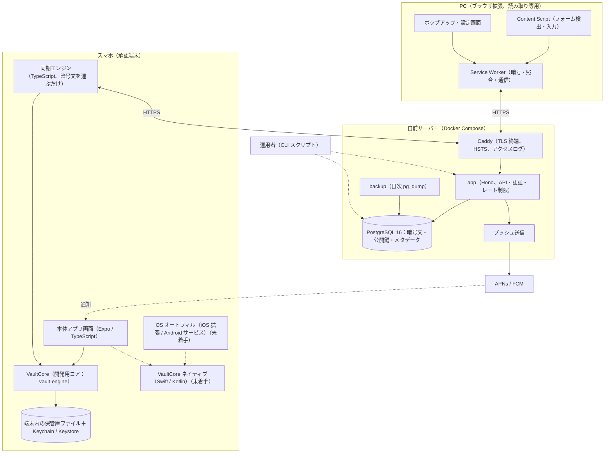
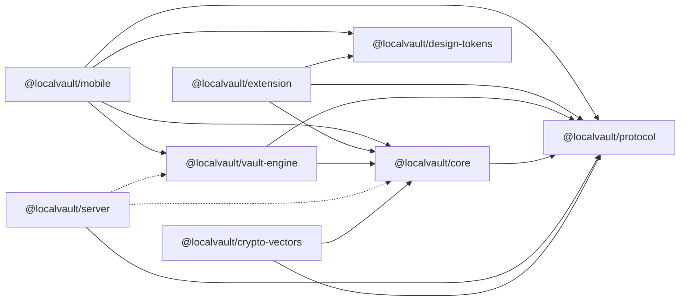
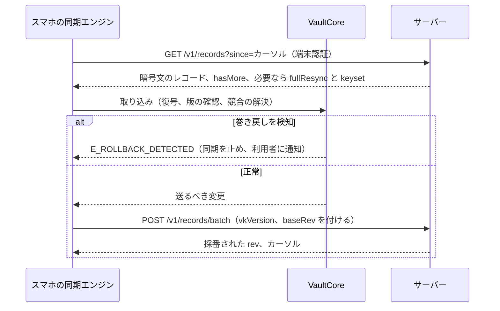
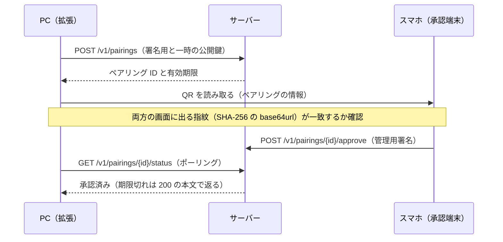
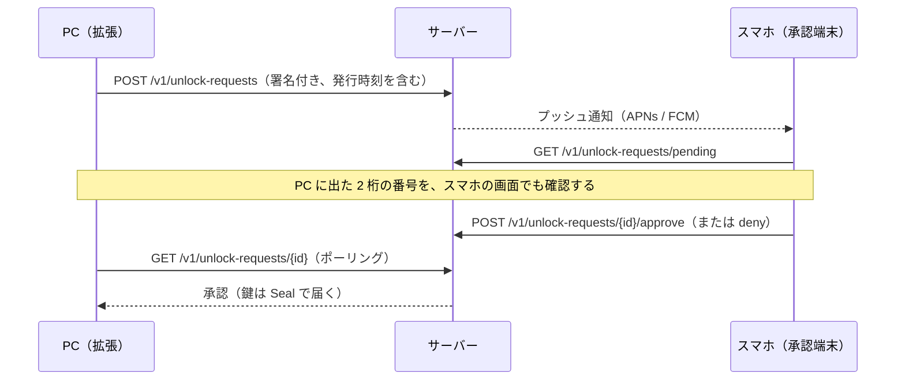

# LocalVault アーキテクチャ

この文書は、現在のコードから読み取れる構成をまとめたものです。仕様の詳細は [spec.md](spec.md)、v0.4 の決定は [spec-review.md](spec-review.md) が優先します。運用は [runbook.md](runbook.md) を参照してください。

## 1. コンポーネント図

ラベルの「（未着手）」は、まだ実装していない部分です。

- 利用者が使う経路は、スマホの画面から VaultCore、同期エンジンから Caddy を経て API と DB です。
- 現在のスマホは、ネイティブの VaultCore の代わりに開発用コア（`@localvault/vault-engine`）で動きます。ネイティブの実装は、同じ VaultCore の契約（`app/packages/core/src/vault-core.ts`）と同じ結果を出すことを、`crypto-vectors` で確かめます。

## 2. パッケージの依存関係

`app/` の各 `package.json` から導出しました。実線は `dependencies`、点線は `devDependencies`（テストや E2E だけで使う）です。

| パッケージ | 役割 | 内部への依存（dependencies） | 内部への依存（devDependencies） |
|---|---|---|---|
| `protocol` | API の型、zod スキーマ、ルート表、署名対象文字列、エラーコード、制限値 | なし | なし |
| `core` | 暗号、レコード、Seal、照合、PSL 判定、CSV 取り込み、VaultCore の契約 | `protocol` | なし |
| `vault-engine` | VaultCore の TypeScript 参照実装（状態、同期、ローテーション、ペアリング） | `core`、`protocol` | なし |
| `design-tokens` | 色、余白、文字、動きの定義（スマホと拡張で共有） | なし | なし |
| `crypto-vectors` | 暗号の互換テスト用ベクタ（JSON）と、それを検査するテスト | `core`、`protocol` | なし |
| `server` | API サーバー（Hono、Kysely、PostgreSQL） | `protocol` | `core`、`vault-engine`（E2E のため） |
| `extension` | ブラウザ拡張（WXT、React） | `core`、`protocol`、`design-tokens` | なし |
| `mobile` | スマホ本体（Expo、expo-router） | `core`、`protocol`、`design-tokens`、`vault-engine` | なし |

- すべての内部パッケージは TypeScript のソースを直接 export します（`"exports": { ".": "./src/index.ts" }`）。ビルドは各アプリ（Expo、WXT、tsup）が行います。
- API の定義は `protocol` だけが持ちます。サーバーとクライアントは同じ定義を使うため、形の食い違いは型検査とテストで止めます。
- 依存は一方向です。`protocol` は他のパッケージに依存せず、`core` は UI やサーバーに依存しません。
- `server` が `core` や `vault-engine` に依存するのは、E2E テストで「仮想のスマホ」と「仮想の PC」を動かすためです。本番のサーバーの実行時には含まれません。

## 3. 信頼の境界

誰が何を読めるかを示します。平文は、利用者の端末のメモリ上にだけ現れます。

| 要素 | 読めるもの | 読めないもの（設計上） |
|---|---|---|
| スマホの画面（JS） | 一覧のタイトルとユーザー名、編集中のパスワード、表示操作をしたパスワード、初期設定時のリカバリーキー。画面を離れると state を破棄 | 保管庫の鍵（VK） |
| スマホの同期エンジン（JS） | なし。暗号文と公開情報だけを運ぶ | 平文すべて |
| VaultCore（ネイティブ、開発用コア） | 平文すべて（メモリ上のみ） | 端末の外へ出る平文 |
| iOS 拡張 / Android サービス（未着手） | 入力する 1 件。一覧表示時はタイトルとユーザー名 | 保管庫の全体 |
| 拡張の Service Worker | セッション中の VK と復号済みの索引（`chrome.storage.session`） | 端末外への平文 |
| 拡張の Content Script | 表示する候補のタイトルとユーザー名、入力する 1 件 | VK、索引 |
| Caddy（ホスト内） | TLS を終端するため、通信の内容（ヘッダーを含む）を一時的に見る。ヘッダー、本文、IP はログに記録しない（パスとステータスは記録する） | 保管庫の平文は含まれない（暗号文だけ） |
| サーバー（app、DB） | 暗号文、公開鍵、メタデータ（アカウント名、端末の公開情報、時刻、監査イベントの種類）。パスワードの検証子は SHA-256(authKey) だけ | マスターパスワード、VK、平文の項目、authKey そのもの |
| バックアップ | サーバーと同じ（暗号文とメタデータ）。`backup_passphrase` があれば二重に暗号化 | 平文 |
| 運用者（ホストの管理者） | 秘密ファイル、DB（暗号文）、ログ（パス、ステータス、所要時間。IP は記録しない） | 保管庫の平文。ただし、サーバーのコードや設定を変えられるため、サーバーを信頼しない設計（クライアントの検知）が必要 |

- サーバーが悪意を持つ場合も、クライアントは改ざんや巻き戻しを検知する設計です（spec §5、§7.5。E2E の `scenario7-malicious-server` が検査）。
- 信頼の前提：端末の OS とアプリの実行環境は信頼します。配布される拡張やアプリが正しいものかを確かめる方法は、配布の方針に従います（拡張の配布は spec §12.8）。

## 4. 主要な流れ

詳細は仕様を参照してください。ここでは流れの骨格だけを示します。

### 4.1 同期（[spec §7](spec.md#7-同期設計)）

- 鍵の版（vkVersion）が違う変更は `E_STALE_KEY`（409）で全体が拒否されます。
- 全件の取り直しと巻き戻しの扱いは [runbook の第 10 章](runbook.md) にあります。

### 4.2 PC のペアリング（[spec §8.3](spec.md#83-pc-のペアリング)）

- 承認の時点で、スマホは PC 宛ての封筒（Seal、spec §8.5）で鍵を渡します。
- 指紋の一致を人が確かめることが、中間者攻撃を防ぐ要です。

### 4.3 解錠（[spec §8.4](spec.md#84-pc-の解錠リクエスト)）

- 発行時刻がサーバー時刻の前後 5 分を外れると `E_CLOCK_SKEW` になります（時刻のずれを防ぐため NTP を使います）。
- 試行回数の制限（FR-12）は、本体アプリと将来のオートフィルで共有します（spec-review G15）。

## 5. テスト戦略

| 層 | 対象 | 場所 | 実行 | 状態 |
|---|---|---|---|---|
| 単体（TypeScript） | `protocol`、`core`、`vault-engine`、`design-tokens`、拡張、スマホ | 各パッケージの `test/`（vitest） | `pnpm test`（全体） | 実装済み |
| 暗号ベクタ | 共通の KDF、AES-GCM、ECDH、ECDSA 検証、Seal、署名対象文字列、復旧コード、`.lvbackup` | `app/packages/crypto-vectors/vectors/*.json`。`test/vectors.test.ts`（WebCrypto と noble）、`test/independent.test.ts`（`node:crypto` で再計算） | `pnpm --filter @localvault/crypto-vectors test` | 参照実装（core）は実装済み。ネイティブ（XCTest、JUnit）は M4 / M5 で追加 |
| サーバー統合 | API、認証、レート制限、ローテーション、復旧、マイグレーション | `app/server/test/`。Testcontainers（`postgres:16`） | `pnpm --filter @localvault/server test`（Docker が必要） | 実装済み |
| E2E | 復元、同期、PC 連携、端末の解除、認証情報、復旧コード、悪意あるサーバー、ゼロ知識（平文が DB に現れないことの検査） | `app/server/e2e/scenario1〜9`。実サーバーをプロセス内で起動し、仮想のスマホ（vault-engine）と仮想の PC（core の部品）で動かす | `pnpm --filter @localvault/server test:e2e`（Docker が必要） | 実装済み |
| 静的検査 | 型、Biome、禁止された通信 SDK、拡張のマニフェスト | 各パッケージの `typecheck`、`pnpm lint`、`pnpm check:deps`、拡張の `check:manifest` | `pnpm typecheck`、`pnpm lint`、`pnpm check:deps` | 実装済み |
| 手動（実機） | 下記の一覧 | — | 人が行う | 未実施 |

**手動で確かめる必要があるもの**（自動化できない、または実機が必要なもの。組み合わせは [spec §17.2](spec.md) を参照）

- iOS オートフィル（シミュレーターと実機、M4）と Android オートフィル（M5）
- 生体認証、自動ロック（前面・背面の切り替え）、画面保護、クリップボードの自動消去
- APNs と FCM による実際の通知の配信、通知から該当画面への遷移
- Chrome と Edge で、実際のサイトに対する候補表示と入力（拡張のテストページは `app/extension/test-pages`）
- 本番ホストでの TLS（Let's Encrypt の取得、HSTS）と、バックアップからの復元の演習（[runbook の第 7 章](runbook.md)）

**既知の差**

- スマホの画面のテストは、一部が fake の VaultCore（`items.fake.test.ts` など）で動きます。ネイティブの VaultCore は未実装のため、暗号は開発用コアの経路だけで検査されています。
- 暗号ベクタは、ネイティブの実装が入るまで Web の実装だけで検査されます。
