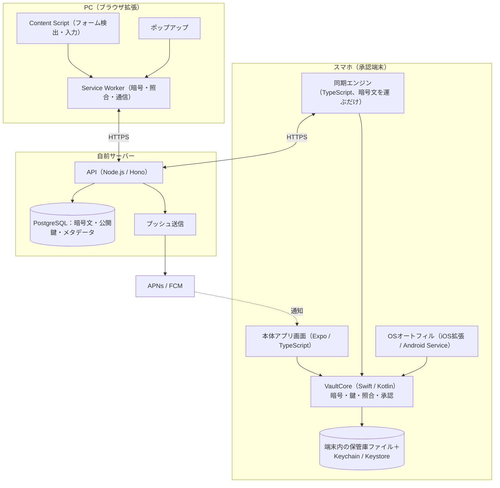
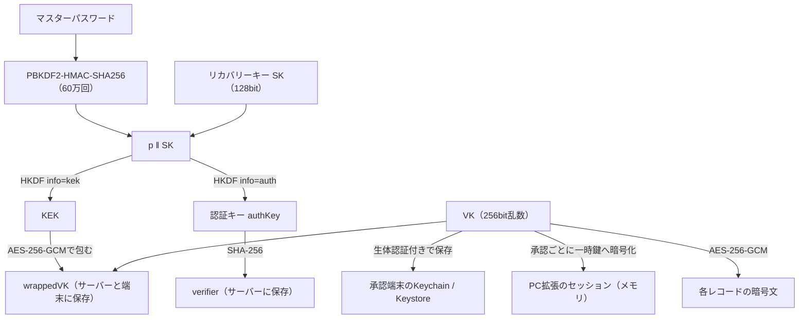
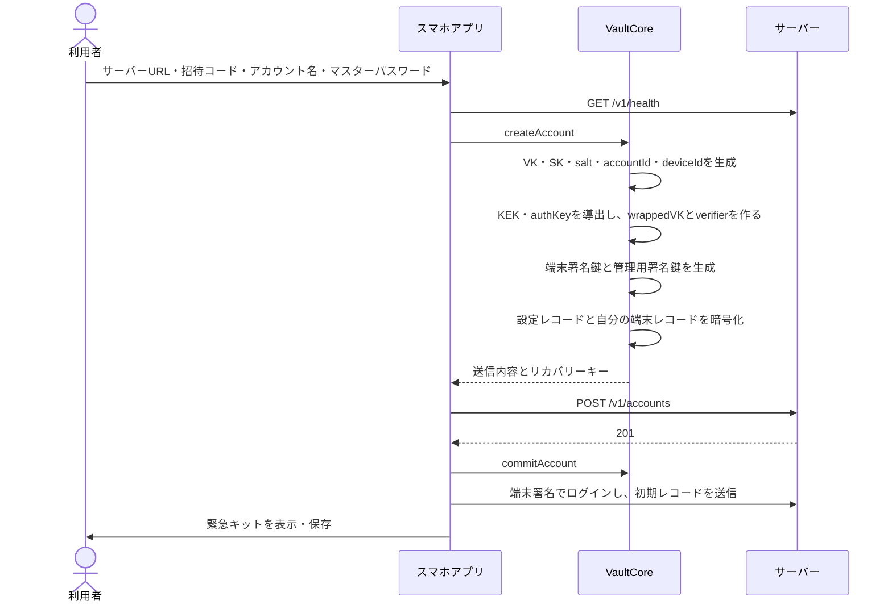
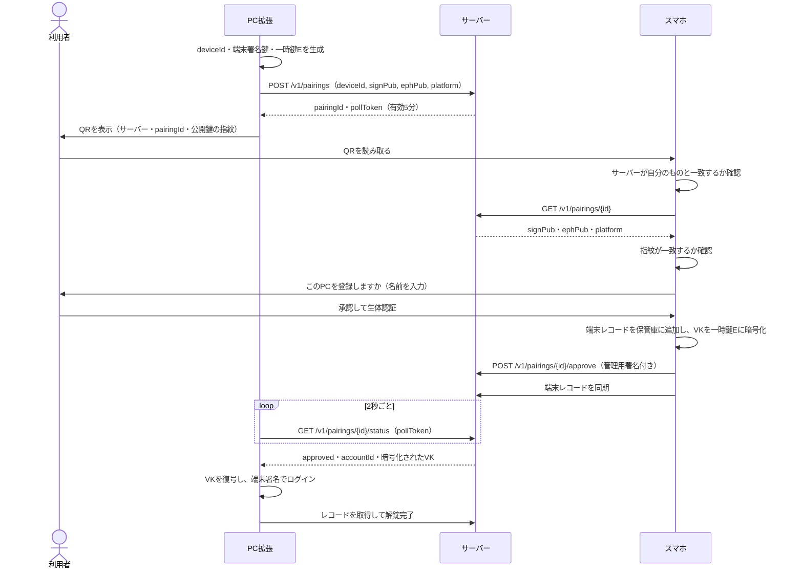
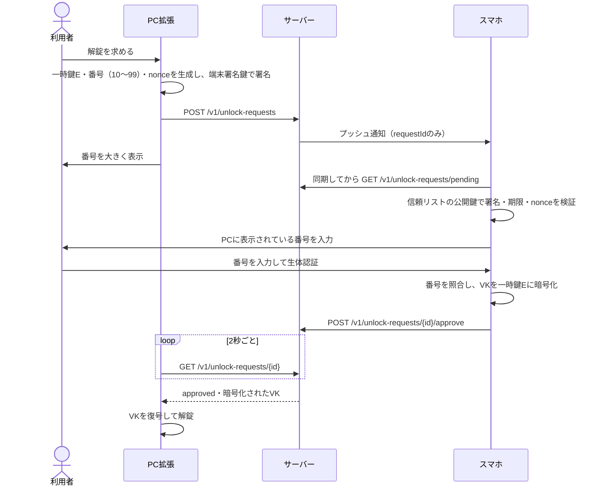
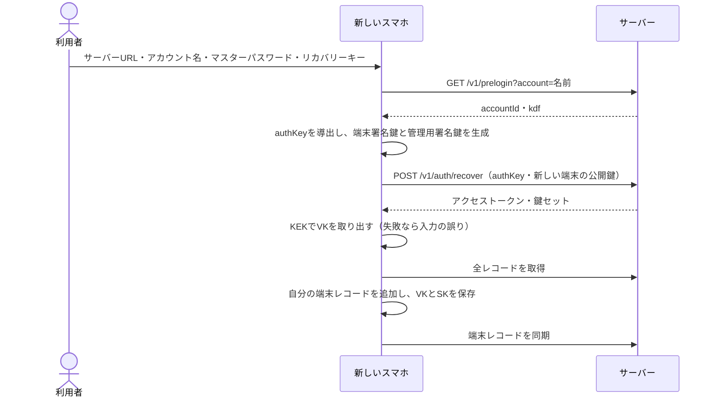
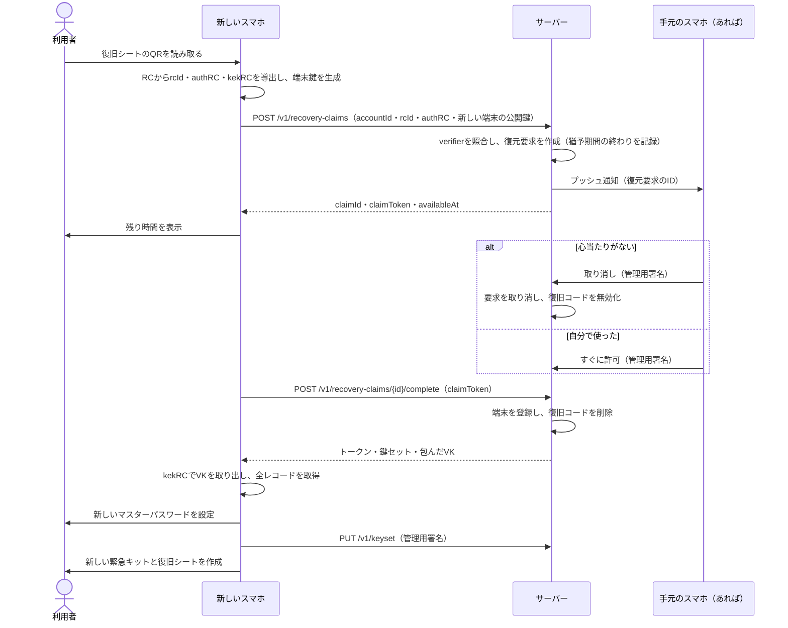
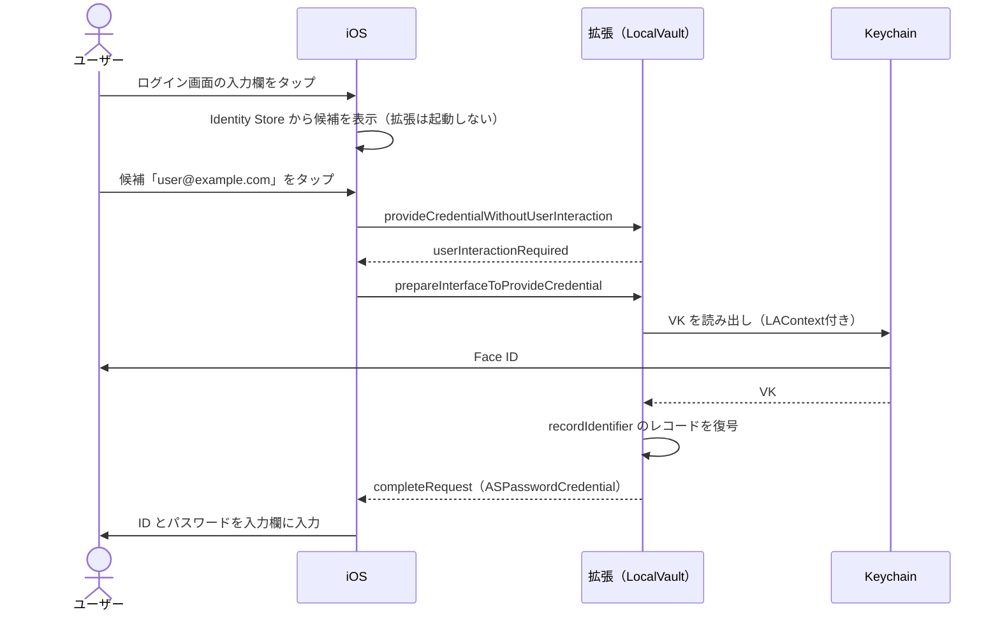
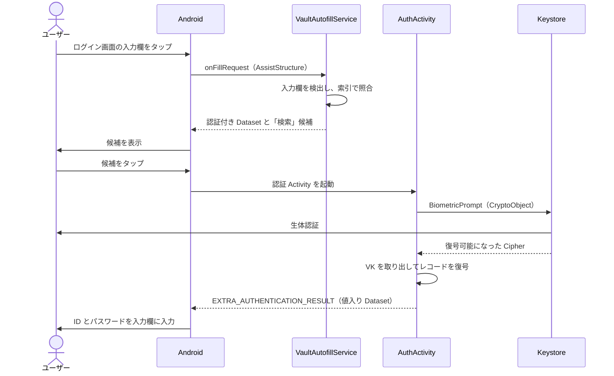

# LocalVault（仮称）仕様・設計書

| 項目 | 内容 |
|---|---|
| 文書バージョン | 0.3（ドラフト） |
| 作成日 | 2026-11-11 |
| 想定読者 | 実装担当者（人、またはAIコーディングエージェント） |
| 前版からの主な変更 | v0.3：復旧シートの QR だけで復元できる「復旧コード」（オプション、猶予期間付き）を追加（§8.11）。v0.2：自前サーバーへの暗号化同期、PC 用ブラウザ拡張（スマホの承認で解錠）、リカバリーキーと緊急キット、端末管理を追加。方針を「通信ゼロ」から「自前サーバー以外と通信せず、サーバーは中身を読めない」に変更 |
| 状態 | §19「要確認事項」は推奨値で仮決めしている。回答があれば差し替えて確定版とする |

> **表記ルール**
> - **【必須】** 満たさなければ受け入れ不可
> - **【推奨】** 明確な理由がない限り従う。従わない場合は理由を記録する
> - **【任意】** 余力があれば実装する
>
> 本書に書かれていない細部は実装者の判断に任せる。ただし §5「セキュリティ設計」と §8「アカウント・端末の登録・承認・復旧」に反する判断はしないこと。

---

## 目次

1. 概要
2. 機能要件
3. 非機能要件
4. 全体アーキテクチャ
5. セキュリティ設計
6. データ設計
7. 同期設計
8. アカウント・端末の登録・承認・復旧
9. 照合ルール（どの項目を候補に出すか）
10. iOS オートフィル拡張 詳細設計
11. Android オートフィルサービス 詳細設計
12. ブラウザ拡張 詳細設計
13. サーバー 詳細設計
14. 本体アプリ 画面仕様
15. ネイティブモジュール API（JS ⇔ ネイティブ）
16. Expo プロジェクト設定
17. テスト・受け入れ基準
18. マイルストーン
19. 要確認事項
20. 参考資料

---

## 1. 概要

### 1.1 目的

スマホ（iOS / Android、Expo 製）でログイン情報を管理し、他のアプリや Web サイトのログイン画面で、**OS のオートフィル機能を通じて候補を表示し、生体認証の後に自動入力する**。

データは端末間で同期するため自前のサーバーに保存する。ただし端末内で暗号化した状態でしか送らないので、**サーバー（運営者や侵入者を含む）は中身を読めない**。

PC ではブラウザ拡張から使える。PC の拡張を解錠するには、**その都度スマホでの承認（PC に表示された番号の入力と生体認証）が必要**で、PC 単体では解錠できない。

### 1.2 基本方針

1. **ゼロ知識**：平文、保管庫の鍵、マスターパスワード、リカバリーキーはサーバーに送らない。サーバーが持つのは、暗号文、公開鍵、最小限のメタデータ（件数・更新日時・端末数など）だけ。
2. **スマホが鍵の持ち主**：保管庫の鍵を常に持つのは、登録済みのスマホ・タブレット（承認端末）だけ。PC の拡張は、承認を受けてからロックされるまでの間だけ、メモリ上に鍵を持つ。
3. **オフラインファースト**：スマホはサーバーに繋がらなくても、閲覧・入力・編集ができる。繋がったときに同期する。
4. **鍵の取り出しを生体認証に結びつける**：「生体認証が成功した」という真偽値で解錠するのではなく、生体認証が成功しないと取り出せない鍵でデータを復号する。
5. **暗号処理を一か所にまとめる**：暗号・鍵管理・照合は、スマホではネイティブ（Swift / Kotlin）、PC では拡張の Service Worker に集約する。画面の層には必要最小限の平文しか渡さない。
6. **第三者に送らない**：通信先は自前サーバーと、プッシュ通知の配信（APNs / FCM）だけ。解析・広告・クラッシュ収集の SDK は入れない。

### 1.3 利用フロー

| フロー | 端末 | 流れ |
|---|---|---|
| **A. 自動入力** | スマホ | ログイン画面で候補をタップ → 生体認証 → ID・パスワードが自動入力される |
| **B. コピー** | スマホ | アプリを開く → 生体認証 → 項目を選択 → コピーボタン → 対象画面に戻って貼り付け |
| **C. テキスト挿入** | iPhone（iOS 18 以上） | 入力欄を長押し →「自動入力」→ 本アプリ → 生体認証 → 項目と種類（ユーザー名／パスワード）を選択 → 挿入 |
| **D. PC で自動入力** | PC ＋ スマホ | ログイン欄の拡張アイコンをクリック → （ロック中なら）PC に 2 桁の番号が出て、スマホに通知が届く → スマホで番号を入力して生体認証 → PC が解錠され、候補を選ぶと入力される |
| **E. 復旧・追加** | 新しいスマホ | アプリを入れる → サーバー URL・アカウント名・マスターパスワード・リカバリーキーを入力 → 保管庫が復元される → 紛失した端末を登録解除する |
| **F. 復旧コードで復元**（オプション） | 新しいスマホ | 復旧シートの QR を読み取る → 猶予期間（既定 48 時間）の間は手元のスマホに通知が届き、取り消せる → 期間が過ぎると復元される → 新しいマスターパスワードを設定する |

### 1.4 スコープ

| 対象 | 対象外（将来検討） |
|---|---|
| iOS / Android アプリ（複数台のスマホ・タブレットに対応） | Web アプリ、デスクトップアプリ |
| Chromium 系ブラウザの拡張（Chrome、Edge、Brave） | Firefox / Safari の拡張 |
| 自前サーバー（API、データベース、プッシュ通知の送信） | 共有、家族・組織での利用 |
| 暗号化同期、端末の登録・解除、リカバリーキーと緊急キット、復旧コード（オプション） | PC での項目の追加・編集・削除（初版は閲覧・入力・コピーのみ） |
| ID・パスワード・URL・メモの保管、パスワード生成 | パスキー、ワンタイムコード（TOTP）、クレジットカード、住所 |
| OS オートフィルによる入力（iOS 拡張／Android AutofillService） | ログイン時の自動保存提案、Android Credential Manager 対応 |
| 暗号化ファイルでのエクスポート／インポート | サーバーを使わない「ローカルのみモード」（§19 Q6） |

データ形式は将来の項目種別の追加に耐えるよう、バージョン番号で拡張できるようにしておく。

### 1.5 対応環境

| 項目 | iOS | Android | PC |
|---|---|---|---|
| 最低バージョン【推奨】 | iOS 17.0 | Android 11（API 30） | Chromium 116 以上（Chrome / Edge / Brave） |
| 生体認証 | Face ID / Touch ID | クラス 3（`BIOMETRIC_STRONG`） | なし（スマホで行う） |
| フロー C | iOS 18 以上で有効 | ―（候補一覧の「検索」で代替） | ― |

- スマホ：Expo（**着手時点の最新安定版 SDK**、New Architecture）、TypeScript、expo-router。**開発ビルド（prebuild / EAS Build）前提。Expo Go では動作しない**。
- サーバー：Linux ＋ Docker が動く環境（VPS、自宅サーバー、NAS など）。外出先から PC の承認を使うには、インターネットから HTTPS で到達できる必要がある。
- 最低 OS の理由：iOS 17 で `ASCredentialRequest` 系 API と `ASSettingsHelper` が使える。Android 11 でキーボード上のインライン候補と `setUserAuthenticationParameters` が使える。Chromium 116 で拡張の Service Worker の扱いが安定する。

### 1.6 用語

| 用語 | 意味 |
|---|---|
| 保管庫（Vault） | アカウントに属する全レコードの集まり |
| レコード | 同期の単位。ログイン情報、端末情報、アカウント設定の 3 種類（§6.1） |
| 項目（Item） | ログイン情報のレコード 1 件 |
| VK（Vault Key） | レコードを暗号化する 256 bit の鍵 |
| KEK（Key Encryption Key） | VK を包む（暗号化する）ための鍵 |
| マスターパスワード | 利用者が覚えるパスワード。生体認証が使えないときの解錠と、復旧に使う |
| リカバリーキー | 端末内で生成する 128 bit の乱数。マスターパスワードと組み合わせて鍵を作る。緊急キットに印字して保管する |
| 緊急キット | サーバー URL、アカウント名、リカバリーキーを載せた PDF。端末内で作り、印刷や保存を促す |
| 復旧コード | オプション。256 bit の乱数で、これだけで（猶予期間の後に）保管庫を復元できる。一回きり |
| 復旧シート | 復旧コードを QR と文字列で載せた PDF。緊急キットとは別の文書 |
| 承認端末 | VK を保持し、PC の解錠を承認できるスマホ・タブレット |
| PC 端末 | ブラウザ拡張。承認を受けている間だけ VK を持つ |
| 端末信頼リスト | 登録済み端末の公開鍵の一覧。保管庫の中に暗号化して保存する（サーバーの情報は信頼しない） |
| 登録ドメイン | Public Suffix List（PSL）に基づく eTLD+1。例：`www.example.co.jp` → `example.co.jp` |
| 関連付け（Android） | 項目と Android アプリ（パッケージ名＋署名）を結びつけること |

---

## 2. 機能要件

### 2.1 初期設定（スマホ）

| ID | 要件 | 区分 |
|---|---|---|
| FR-01 | サーバー URL を入力し、接続を確認する（`GET /v1/health`）。`https://` 以外は受け付けない。「新しく作成」「既存のアカウントで復旧・追加」を選ばせる | 必須 |
| FR-02 | 新規作成：招待コード、アカウント名（3〜32 文字、英小文字・数字・`.`・`_`・`-`）、マスターパスワード（10 文字以上、確認入力、強度表示）を入力する | 必須 |
| FR-03 | リカバリーキーを端末内で生成し、緊急キット（PDF）を端末内で作成して、保存・印刷を促す。リカバリーキーの末尾 4 文字を入力させ、控えたことを確認するまで先に進めない。「マスターパスワードとリカバリーキーの両方を失うと、誰にも復旧できない」旨を表示し、同意チェックを得る | 必須 |
| FR-04 | 生体認証の有効化を案内する。端末が未対応・未登録ならスキップし、マスターパスワードのみで運用できる | 必須 |
| FR-05 | プッシュ通知の許可を求める（PC からの解錠リクエストを受けるため）。拒否された場合は「アプリを開けばリクエストを確認できる」旨を表示する | 必須 |
| FR-06 | オートフィルの有効化を案内する（§10.6、§11.7） | 必須 |

### 2.2 ロック・解錠（スマホ）

| ID | 要件 | 区分 |
|---|---|---|
| FR-10 | 起動時・復帰時はロック状態。生体認証で解錠する。失敗・キャンセル時はマスターパスワード入力に切り替えられる | 必須 |
| FR-11 | 自動ロック：バックグラウンドへ移行してから設定時間（即時／30 秒／1 分／5 分、既定 1 分）が経過していたら、復帰時にロックする。一覧画面に手動ロックボタンを置く | 必須 |
| FR-12 | マスターパスワードを 5 回連続で間違えたら 30 秒待機。以降、失敗ごとに待機時間を倍にする（上限 15 分）。待機状態はアプリ再起動でも維持する | 必須 |
| FR-13 | 生体情報の追加・変更などで生体認証用の鍵が無効化された場合、マスターパスワードで解錠したうえで、生体認証と管理用署名鍵（§5.2）を再設定できる | 必須 |
| FR-14 | マスターパスワードを忘れた場合：生体認証で解錠できる端末があれば、リカバリーキーを入力して新しいマスターパスワードを設定できる（§8.10） | 必須 |

### 2.3 項目管理（スマホ）

| ID | 要件 | 区分 |
|---|---|---|
| FR-20 | 項目の作成・編集・削除。削除は確認ダイアログを出す | 必須 |
| FR-21 | 項目のフィールド：タイトル、ユーザー名、パスワード、URL（複数）、メモ、お気に入り（詳細は §6.1） | 必須 |
| FR-22 | 一覧：検索（タイトル・ユーザー名・ドメインの部分一致、大文字小文字・全角半角を区別しない）、並び替え（最近使った順／名前順）、お気に入りを上部に固定 | 必須 |
| FR-23 | パスワード生成：長さ 8〜64（既定 20）、英大文字／英小文字／数字／記号の選択、紛らわしい文字（`Il1O0` 等）の除外。暗号学的乱数を使う | 必須 |
| FR-24 | アイコンはタイトルの頭文字による文字アバターを端末内で生成する。ファビコンの取得はしない | 必須 |
| FR-25 | 詳細画面で、関連付けられた Android アプリの一覧表示と解除ができる（追加は §9.2 のフローで行う） | 必須 |
| FR-26 | 詳細画面の URL をタップすると OS 既定のブラウザで開く | 任意 |
| FR-27 | 削除した項目は 30 日間「最近削除した項目」から復元できる（§7.6） | 推奨 |

### 2.4 フロー B：コピー（スマホ）

| ID | 要件 | 区分 |
|---|---|---|
| FR-30 | 一覧の各行と詳細画面に「ユーザー名をコピー」「パスワードをコピー」ボタンを置く | 必須 |
| FR-31 | コピーはネイティブ側で実行し、パスワードを JS 層に渡さない（§15） | 必須 |
| FR-32 | クリップボード保護（§5.10）。消去までの時間は既定 60 秒（設定で 30 秒／60 秒／2 分／消去しない） | 必須 |
| FR-33 | コピー後に「コピーしました（60 秒後に消去）」のようなトーストを表示する | 必須 |
| FR-34 | ユーザー名をコピーした後、同じ行の「パスワードをコピー」ボタンを 10 秒間強調表示する | 推奨 |

### 2.5 フロー A・C：オートフィル（スマホ）

| ID | 要件 | 区分 |
|---|---|---|
| FR-40 | iOS：ログイン画面のキーボード上に候補（ユーザー名）を表示し、タップ → 生体認証 → 自動入力 | 必須 |
| FR-41 | iOS：キーボードの鍵アイコン等から本アプリを選んだ場合、生体認証の後に一覧（対象サイトに一致する項目を先頭）を表示し、選択すると入力する | 必須 |
| FR-42 | iOS 18 以上：テキスト挿入（フロー C）に対応する。未対応だと、入力欄の長押しメニューから本アプリを選んだときに、OS が「自動入力を利用できません」という趣旨のエラーを出すため | 必須 |
| FR-43 | Android：ログイン画面で候補（ドロップダウン、または対応キーボードのインライン候補）を表示し、タップ → 生体認証 → 自動入力 | 必須 |
| FR-44 | Android：一致する項目がない場合も「LocalVault で検索」候補を出し、生体認証 → 検索 → 選択で入力できる | 必須 |
| FR-45 | 候補の照合は §9 のルールに従う | 必須 |
| FR-46 | 設定「認証前にユーザー名を候補に表示する」（既定オン）。オフの場合、iOS は Identity Store に登録せず、Android は「LocalVault（ロック中）」とだけ表示する | 推奨 |

### 2.6 同期

| ID | 要件 | 区分 |
|---|---|---|
| FR-70 | 項目の追加・編集・削除は端末内に即時保存し、オンラインならすぐサーバーへ送る。オフライン中の変更は保持し、接続したときに送る | 必須 |
| FR-71 | 同期のタイミングは §7.8 に従う | 必須 |
| FR-72 | 同じ項目を複数の端末で編集した場合、§7.4 に従って片方を「（競合コピー）」として残す。データを黙って失わない | 必須 |
| FR-73 | 一覧の上部に同期状態（同期済み／同期中／オフライン／エラー）と最終同期時刻を表示する。エラー時はタップで詳細を表示する | 必須 |
| FR-74 | サーバーのデータの巻き戻しを検知したら同期を止めて警告する（§7.5） | 必須 |

### 2.7 PC（ブラウザ拡張）

| ID | 要件 | 区分 |
|---|---|---|
| FR-80 | 初回はサーバー URL を設定し、拡張に QR コードを表示する。スマホで読み取って登録する（ペアリング、§8.3）。ペアリングの承認と同時に初回の解錠も行う | 必須 |
| FR-81 | ロック中に解錠を求めると、PC に 2 桁の確認番号を表示し、承認端末に通知を送る。スマホで番号を入力して生体認証すると解錠される（§8.4） | 必須 |
| FR-82 | 承認端末で拒否できる。「身に覚えがない」を選ぶと、拒否したうえでその PC の登録解除画面に進む | 必須 |
| FR-83 | PC のセッションは、次のいずれかでロックする：最長時間（承認端末側の設定。1 回のみ／15 分／1 時間／8 時間。既定 1 時間）、PC の無操作 15 分、PC の画面ロック、ブラウザの終了、手動ロック | 必須 |
| FR-84 | ログインフォームの入力欄に拡張のアイコンを表示し、クリックすると一致する候補を表示する。選ぶと入力する。**ページを開いただけで自動入力はしない** | 必須 |
| FR-85 | ツールバーのポップアップ：ロック状態、解錠ボタン、検索（開いているタブに一致する項目を先頭）、ユーザー名・パスワードのコピー、手動ロック | 必須 |
| FR-86 | PC では項目の追加・編集・削除はできない（初版） | 必須 |
| FR-87 | 拡張の設定：サーバー URL、ペアリングの解除、クリップボード消去時間 | 必須 |

### 2.8 端末管理

| ID | 要件 | 区分 |
|---|---|---|
| FR-90 | 承認端末で、登録されている端末（スマホ・PC）の一覧（名前、種類、登録日、最終利用日時）を表示する | 必須 |
| FR-91 | 端末の登録解除。解除された端末はサーバーにアクセスできなくなる。解除時に「保管庫の鍵を更新する」を選べる（§8.8） | 必須 |
| FR-92 | 承認端末の追加は、マスターパスワードとリカバリーキーで行う（復旧と同じ手順、§8.6） | 必須 |
| FR-93 | 端末の名前を変更できる。名前は保管庫内に暗号化して保存し、サーバーには送らない | 必須 |
| FR-94 | 既存のスマホで QR を読み取って新しいスマホを追加する方法 | 任意 |

### 2.9 アカウント

| ID | 要件 | 区分 |
|---|---|---|
| FR-100 | 復旧：サーバー URL、アカウント名、マスターパスワード、リカバリーキー（緊急キットの QR の読み取り、または手入力）で保管庫を復元する | 必須 |
| FR-101 | マスターパスワードの変更（現在のパスワードが必要） | 必須 |
| FR-102 | リカバリーキーの再発行（マスターパスワードが必要）。新しい緊急キットを作る。古いキーは使えなくなる | 必須 |
| FR-103 | 緊急キットの再作成（リカバリーキーは同じ。生体認証が必要） | 必須 |
| FR-104 | アカウントの削除：サーバー上のデータをすべて削除し、端末内のデータも消去する。マスターパスワードの再入力が必要 | 必須 |
| FR-105 | 復旧コード（§8.11）を設定で有効にできる。既定はオフ。有効化の画面で「復旧シートだけで全データを開ける」ことを明示し、同意を得る。有効化には生体認証が必要 | 必須 |
| FR-106 | 復旧シート（PDF）を端末内で作り、印刷・保存を促す。文字列の末尾 6 文字を入力させて、控えたことを確認する。作成後は一時ファイルを削除し、復旧コードを端末に残さない | 必須 |
| FR-107 | 新しいスマホで復旧シートの QR（読めない場合は文字列）を読み取ると、猶予期間の後に復元される。復元後は新しいマスターパスワードの設定を必須とする | 必須 |
| FR-108 | 猶予期間中は手元の承認端末に通知し、「取り消す」「自分で使った（すぐに許可）」を選べるようにする | 必須 |
| FR-109 | 復旧コードは一回きり。使用後・鍵の更新後・取り消し後は無効になり、新しい復旧コードの発行と印刷を促す（控えの確認が済むまで一覧にバナーを出す） | 必須 |
| FR-110 | 猶予期間は 24／48／72 時間から選ぶ（既定 48 時間。0 にはできない）。復旧コードの無効化と再発行ができる | 必須 |

### 2.10 バックアップ

サーバーとは別に、サーバーの障害や運用終了に備えた手段として残す。

| ID | 要件 | 区分 |
|---|---|---|
| FR-50 | エクスポート：エクスポート用パスワード（10 文字以上）で暗号化したファイル（§6.5）を作り、共有シートで保存先をユーザーに選ばせる | 必須 |
| FR-51 | インポート：ファイル選択 → パスワード入力 → 件数と重複数のプレビュー → 取り込み方法（すべて追加／同じ ID は更新日時が新しい方を採用／全置換）を選択。取り込んだ結果は同期される | 必須 |
| FR-52 | iOS で書き出したファイルを Android で読み込める（逆も同様） | 必須 |
| FR-53 | 設定画面に最終エクスポート日を表示する。90 日以上空いたら一覧上部のバナーで促す | 推奨 |

### 2.11 設定（スマホ）

| ID | 要件 | 区分 |
|---|---|---|
| FR-60 | 設定項目：自動ロック時間、クリップボード消去時間、生体認証のオン／オフ、認証前のユーザー名表示、オートフィルの状態と有効化への誘導、PC セッションの最長時間、端末管理、アカウント（マスターパスワード変更、リカバリーキー再発行、緊急キット再作成、復旧コード、アカウント削除）、エクスポート／インポート、サーバー情報（URL、バージョン、同期状態）、ライセンス表示 | 必須 |

---

## 3. 非機能要件

| ID | 要件 | 区分 |
|---|---|---|
| NFR-01 | **通信先の制限**：本体アプリと拡張は、設定したサーバー（HTTPS のみ）とだけ通信する。プッシュ通知は OS（APNs / FCM）経由で受け取る。iOS オートフィル拡張と Android オートフィルサービスは通信しない。第三者の SDK（解析・広告・クラッシュ収集・Expo のプッシュ中継・OTA 更新）を入れない（§5.11） | 必須 |
| NFR-02 | 平文のパスワード・ユーザー名・URL・端末名を、ログ、例外メッセージ、クラッシュ出力に含めない。リリースビルドでは JS の `console.*` を除去する。サーバーはリクエスト本文と認証情報をログに出さない | 必須 |
| NFR-03 | スマホの解錠（生体認証成功）から一覧表示まで 1 秒以内（1,000 件時） | 推奨 |
| NFR-04 | Android の `onFillRequest` は 300 ms 以内に応答する（保管庫本体は復号しない） | 必須 |
| NFR-05 | iOS 拡張は軽量に保つ。React Native を拡張に載せない。UI は SwiftUI で書く | 必須 |
| NFR-06 | 端末内の書き込みはアトミックに行い、直前の 1 世代をバックアップとして保持する | 必須 |
| NFR-07 | 画面保護：Android は全画面で `FLAG_SECURE`、iOS はアプリ切り替え時にプライバシー画面で覆う | 必須 |
| NFR-08 | VoiceOver / TalkBack のラベル、文字サイズ変更、ダークモードに対応する | 推奨 |
| NFR-09 | 文言は i18n ファイルに分離する（初版は日本語のみ） | 推奨 |
| NFR-10 | オフライン時も、スマホは PC の承認以外のすべての機能を使える | 必須 |
| NFR-11 | PC の解錠：スマホでの承認操作の完了から PC が解錠されるまで 3 秒以内 | 推奨 |
| NFR-12 | サーバーの上限：1 アカウントあたり 10,000 レコード、1 レコードの暗号文は 64 KB まで。単一のインスタンスで 100 アカウント程度（個人・家族用）を想定する | 必須 |
| NFR-13 | サーバーの DB は毎日バックアップする（§13.9） | 必須 |
| NFR-14 | 暗号処理は iOS（Swift）・Android（Kotlin）・拡張（WebCrypto）で同じ結果になることを、共通のテストベクタで確認する（§17.1） | 必須 |

---

## 4. 全体アーキテクチャ

### 4.1 構成図



### 4.2 リポジトリ構成（モノレポ、pnpm workspaces）

```
localvault/
├─ apps/
│  ├─ mobile/                       # Expo アプリ
│  │  ├─ app.config.js  eas.json
│  │  ├─ app/                       # expo-router の画面（§14）
│  │  ├─ src/
│  │  │  ├─ components/ hooks/ i18n/ theme/
│  │  │  ├─ native/VaultCore.ts     # ネイティブモジュールの型付きラッパー（§15）
│  │  │  ├─ api/                    # サーバー API クライアント（packages/protocol の型を使う）
│  │  │  └─ sync/                   # 同期エンジン（§7）
│  │  ├─ modules/
│  │  │  ├─ vault-kit/ios/          # VaultKit：ローカル Pod（純 Swift、拡張でも使える API のみ）
│  │  │  └─ vault-core/             # Expo ローカルモジュール（iOS 橋渡し＋Android 実装）
│  │  │     ├─ ios/VaultCoreModule.swift
│  │  │     └─ android/src/main/
│  │  │        ├─ AndroidManifest.xml
│  │  │        ├─ res/xml/autofill_service_config.xml
│  │  │        └─ java/<package>/
│  │  │           ├─ core/        # Crypto, VaultStore, KeyManager, DeviceKeys, Seal,
│  │  │           │               # AutofillIndex, Matcher, Psl, RecordCodec
│  │  │           ├─ autofill/    # VaultAutofillService, StructureParser, ResponseBuilder,
│  │  │           │               # AuthActivity, PickerActivity
│  │  │           ├─ clipboard/   # SecureClipboard
│  │  │           └─ VaultCoreModule.kt
│  │  ├─ targets/autofill/          # iOS オートフィル拡張（@bacons/apple-targets）
│  │  └─ plugins/                   # 自作 config plugin
│  ├─ extension/                    # ブラウザ拡張（MV3、§12）
│  │  └─ src/{background,content,popup,options,offscreen,core}/
│  └─ server/                       # API サーバー（§13）
│     ├─ src/{routes,db,auth,push,jobs}/
│     ├─ migrations/
│     └─ docker-compose.yml  Caddyfile  Dockerfile
├─ packages/
│  ├─ protocol/                     # API の型・zod スキーマ・署名対象文字列の生成関数（TS）
│  └─ crypto-vectors/               # 暗号の互換テスト用ベクタ（JSON）
└─ shared/
   └─ public_suffix_list.dat        # PSL（ビルド時にスマホと拡張に同梱）
```

### 4.3 iOS のコード共有【必須】

- VaultKit のソースは 1 か所で管理する。**コピーによる二重管理は禁止**。
- 推奨構成：VaultKit をローカル Pod にし、vault-core の podspec から `s.dependency 'VaultKit'` で参照する。オートフィル拡張のターゲットにも同じ Pod を追加する（apple-targets のターゲット別 Pod 指定。使えない場合は Podfile を編集する config plugin）。
- VaultKit は拡張で使えない API（`UIApplication.shared` など）を使わない。

### 4.4 責務の分担

| 層 | 責務 | 扱う平文 |
|---|---|---|
| スマホの画面（JS） | 画面表示、入力フォーム、画面遷移 | 一覧のタイトル・ユーザー名、編集中のパスワード、表示操作をしたパスワード、初期設定時のリカバリーキー表示のみ。画面を離れたら state を破棄する |
| スマホの同期エンジン（JS） | サーバーとの通信、再試行、同期状態の管理 | なし（暗号文と公開情報だけを運ぶ） |
| VaultKit / vault-core | 暗号、鍵管理、保存、照合、クリップボード、索引、生体認証、自動ロック、承認と署名、競合解決 | すべて（メモリ上のみ） |
| iOS 拡張 / Android Service | OS とのやり取り、認証 UI、候補一覧 UI | 入力する 1 件（一覧表示時はタイトル・ユーザー名） |
| 拡張の Service Worker | サーバー通信、暗号、照合、セッション管理、送信元フレームの検証 | セッション中の VK と索引 |
| 拡張の Content Script | フォーム検出、候補表示、入力 | 表示する候補のタイトル・ユーザー名、入力する 1 件 |
| サーバー | 暗号文の保存と配信、端末認証、承認リクエストの中継、プッシュ送信 | なし |

---

## 5. セキュリティ設計

### 5.1 脅威モデル

**守る対象**

| 脅威 | 対策 |
|---|---|
| サーバーの DB の流出 | 暗号文しかない。鍵はマスターパスワードと 128 bit のリカバリーキーの組み合わせから作るため、総当たりで解読できない。件数・更新日時・端末数は漏れる（許容する） |
| 悪意あるサーバー：偽の端末を登録させる | 承認端末は、保管庫内（暗号化済み）の端末信頼リストだけを信頼する。PC の公開鍵は QR で指紋を直接受け渡し、サーバーが差し替えられないようにする（§8.3） |
| 悪意あるサーバー：VK を横取りする | 承認端末は、信頼リストの公開鍵で署名を検証した一時鍵にだけ VK を暗号化して送る（§8.4、§8.5） |
| 通信の盗聴・改ざん | HTTPS に加え、上記の端末間の暗号化。TLS が破られても中身は読めない |
| PC の盗難 | 拡張は VK をディスクに保存しない。解錠には、スマホでの承認と、PC の画面に出た番号の入力が必要。承認端末から登録を解除できる |
| スマホの盗難・紛失 | 生体認証かマスターパスワードがないと VK を取り出せない。端末の登録・解除や鍵の変更には、生体認証付きの管理用署名鍵が必要（§8.7） |
| 承認通知の連打（誤って承認させる攻撃） | PC の画面に出た番号の入力を必須にし、ボタンを押すだけでは承認できないようにする。番号はリクエストごとに変わる |
| 復旧シートの盗難・複製（復旧コードを有効にした場合） | 猶予期間（既定 48 時間）中に承認端末へ通知し、本人が取り消せる。一回きり。同時に 2 か所から使われたら凍結する。防げない場合は §8.11.7 |
| 悪意ある Web ページ | ユーザーがクリックしたときだけ入力する。入力先フレームのオリジンを Service Worker が検証する。見えない入力欄には入力しない（§12.6） |
| 他アプリによる読み取り（クリップボード経由を含む） | §5.10 |
| 偽アプリ・偽サイトへの誤入力 | §9 の照合ルール |
| OS バックアップ経由の流出 | 端末内の保管庫は OS のバックアップから除外する |
| 画面の盗み見・スクリーンショット | §5.9 |

**前提とし、守らない対象**

- ジェイルブレイク／root 化された端末、マルウェアに感染した PC（解錠中の PC のメモリは読まれうる）
- 解錠中の端末を第三者に操作される
- OS、ブラウザ、生体認証そのものの脆弱性
- ブラウザ拡張の配布経路（ストアのアカウント）の乗っ取り
- マスターパスワードとリカバリーキーの両方の漏えい
- サーバーによるサービス妨害（データの削除・巻き戻し・応答拒否）。巻き戻しは検知する（§7.5）が、防ぐことはできない。スマホ内のデータは残る

### 5.2 鍵の一覧

| 鍵 | 生成 | 保存場所 | 用途 |
|---|---|---|---|
| VK（256 bit） | アカウント作成時、承認端末 | 承認端末（生体認証付き）。PC はセッション中のメモリのみ。サーバーには包んだ形のみ | レコードの暗号化 |
| リカバリーキー（SK、128 bit） | アカウント作成時、承認端末 | 緊急キット、承認端末の Keychain / Keystore（生体認証なし・この端末のみ）、保管庫内の設定レコード | KEK と認証キーの材料 |
| KEK | マスターパスワード＋SK から都度導出 | 保存しない | VK を包む |
| 認証キー（authKey） | マスターパスワード＋SK から都度導出 | 保存しない。サーバーは SHA-256 のみ保存 | 復旧時・管理操作時のサーバーへの認証 |
| 端末署名鍵（ECDSA P-256） | 端末登録時 | スマホ：Secure Enclave / Android Keystore（生体認証なし）。PC：WebCrypto の抽出不可の鍵を IndexedDB に | サーバーへのログイン。PC は解錠リクエストへの署名にも使う |
| 管理用署名鍵（ECDSA P-256、スマホのみ） | 端末登録時 | Secure Enclave / Android Keystore（生体認証必須） | 端末の登録・解除、鍵セットの変更、鍵の更新、アカウント削除 |
| 一時鍵（ECDH P-256） | リクエストごと | メモリのみ（PC は進行中だけ `chrome.storage.session`） | VK の受け渡し |
| 復旧コード（RC、256 bit、オプション） | 有効化時・再発行時、承認端末 | 復旧シート（紙）のみ。端末には保存しない（復元待ちの新しい端末を除く）。サーバーは包んだ VK と verifier のみ | 単独で VK を取り出す（猶予期間付き、§8.11） |



- 生体認証の経路は、生体情報の変更や機種変更で失われる前提とする。**マスターパスワード＋リカバリーキーが唯一の復旧手段**になる。
- マスターパスワードの変更とリカバリーキーの再発行では VK を作り直さず、包み直す（鍵セットの版 `keysetVersion` だけ上げる）。
- 端末内では SK が Keychain / Keystore にあるため、利用者はマスターパスワードだけで解錠できる。新しい端末ではリカバリーキーの入力が必要になる。

### 5.3 暗号方式

| 用途 | 方式 |
|---|---|
| データの暗号化 | AES-256-GCM。nonce は 96 bit で暗号化ごとに乱数、認証タグ 128 bit。AAD は用途ごとに §6、§8.5 で定める |
| パスワードからの鍵導出 | PBKDF2-HMAC-SHA256、反復 600,000 回、salt 16 バイト。パラメータは鍵セットに保存し、将来引き上げられるようにする |
| 鍵の派生 | HKDF-SHA256 |
| 鍵の受け渡し | ECDH P-256 ＋ HKDF-SHA256 ＋ AES-256-GCM（§8.5） |
| 署名 | ECDSA P-256 ＋ SHA-256 |
| 公開鍵の表現 | SEC1 非圧縮形式（65 バイト）を base64url（パディングなし） |
| 署名の表現 | r ‖ s の 64 バイト（IEEE P1363 形式）。Android の `Signature` が出す DER 形式は変換する |
| base64 | API、QR、署名対象の文字列は base64url（パディングなし）。端末内ファイルも同じとする |
| 乱数 | iOS：`SecRandomCopyBytes`、Android：`SecureRandom`、拡張：`crypto.getRandomValues` |
| 実装 | iOS：CryptoKit（`AES.GCM`、`HKDF`、`P256`、`SecureEnclave.P256`）＋ CommonCrypto（PBKDF2）／ Android：`javax.crypto`、`java.security`、Android Keystore ／ 拡張：WebCrypto（`crypto.subtle`） |
| 禁止 | 独自の暗号アルゴリズム、ECB、nonce の再利用、パスワードのハッシュ比較による端末内認証（復号の成否で判定する） |

Argon2id は外部ライブラリが必要なため採用しない。リカバリーキー（128 bit）を混ぜるため、マスターパスワードの強度にかかわらずサーバー流出時の総当たりは成立しない。

### 5.4 鍵の導出（KEK・認証キー）

```
p         = PBKDF2-HMAC-SHA256(NFKC(マスターパスワード), kdf.salt, 600000, 32)
ikm       = p ‖ SK                                  （48 バイト）
salt      = accountId の UUID 16 バイト
KEK       = HKDF-SHA256(ikm, salt, "localvault/v2/kek",  32)
authKey   = HKDF-SHA256(ikm, salt, "localvault/v2/auth", 32)
wrappedVK = AES-256-GCM(KEK, VK, AAD = "lv|v2|vk|<accountId>|<keysetVersion>")
verifier  = SHA-256(authKey)                         ← サーバーに保存する
```

- マスターパスワードは NFKC で正規化する。前後の空白は削らない。
- authKey はサーバーへの認証にだけ使い、KEK とは HKDF の info で分ける。サーバーが authKey を知っても KEK は求められない。

### 5.5 リカバリーキーと緊急キット

**リカバリーキーの形式**

- 128 bit の乱数を Crockford Base32 で 26 文字にし（末尾 2 bit は 0 で埋める）、SHA-256(SK) の先頭 10 bit から作った 2 文字の検査文字を足して 28 文字にする。
- 表示：`LV2-XXXX-XXXX-XXXX-XXXX-XXXX-XXXX-XXXX`（4 文字ずつ 7 組）
- 入力：大文字小文字を区別しない。ハイフンと空白は無視する。Crockford の規則に従い `I`・`L` は `1`、`O` は `0` として読む。検査文字が合わなければ、送信前に「入力に誤りがあります」と表示する。

**緊急キット（PDF）**

- 端末内で作る（expo-print、QR の生成も端末内）。
- 載せる内容：アプリ名、作成日、サーバー URL、アカウント名、リカバリーキー（文字と QR）、マスターパスワードの記入欄（空欄。書くかどうかは任意と注記）、注意書き（「この紙とマスターパスワードがあれば、誰でもデータを開けます」「両方を失うと誰にも復旧できません」）。
- QR の内容：`lvkit:v1?s=<サーバーURL（base64url）>&a=<アカウント名>&k=<リカバリーキー>`
- 作成後は一時ファイルを削除する。
- 復旧コード（オプション）の復旧シートは、緊急キットとは別の文書にする（§8.11.2）。

### 5.6 保管場所

| データ | iOS | Android | PC 拡張 | サーバー |
|---|---|---|---|---|
| 保管庫レコード | App Group 内 `vault/vault.lv`。File Protection `.complete`。OS バックアップから除外 | `noBackupFilesDir/vault.lv`。`allowBackup=false` | `chrome.storage.local`（暗号文のキャッシュ） | `records` テーブル（暗号文） |
| 生体認証用の VK | Keychain の GenericPassword。共有アクセスグループ、`kSecAttrAccessibleWhenPasscodeSetThisDeviceOnly` ＋ `.biometryCurrentSet`、同期なし | Keystore の AES-256 鍵 `vault_bio`（`setUserAuthenticationRequired(true)`、`setUserAuthenticationParameters(0, AUTH_BIOMETRIC_STRONG)`、`setInvalidatedByBiometricEnrollment(true)`、StrongBox が使えれば使う）で VK を包み、`noBackupFilesDir/vk.bio` に保存 | `chrome.storage.session`（セッション中のみ） | 包んだ形のみ（`accounts.wrapped_vk`） |
| リカバリーキー | Keychain（共有アクセスグループ、`kSecAttrAccessibleWhenUnlockedThisDeviceOnly`、生体認証なし） | Keystore の鍵 `sk_wrap`（認証不要、`setUnlockedDeviceRequired(true)`）で暗号化し `noBackupFilesDir/sk.bin` | 持たない | 持たない |
| 端末署名鍵 | Secure Enclave（`kSecAttrAccessibleWhenUnlockedThisDeviceOnly`） | Keystore（EC P-256、署名用、認証不要） | IndexedDB（`CryptoKey`、`extractable: false`） | 公開鍵のみ |
| 管理用署名鍵 | Secure Enclave（`.privateKeyUsage` ＋ `.biometryCurrentSet`） | Keystore（EC P-256、`setUserAuthenticationParameters(10, AUTH_BIOMETRIC_STRONG)`、`setInvalidatedByBiometricEnrollment(true)`） | なし | 公開鍵のみ |
| オートフィル用の索引 | OS の `ASCredentialIdentityStore`（ドメイン・ユーザー名・項目 ID のみ） | `noBackupFilesDir/autofill.idx`（§6.4） | `chrome.storage.session`（復号済みの索引、セッション中のみ） | なし |
| 使用履歴 | App Group 内 `vault/usage.lv`（VK で暗号化、同期しない） | `noBackupFilesDir/usage.lv`（同上） | なし | なし |
| 設定値 | App Group の UserDefaults（秘密情報は入れない） | SharedPreferences（同上） | `chrome.storage.local`（同上） | ― |

### 5.7 生体認証の実装ルール

- 【必須】expo-local-authentication などの「成功／失敗」の結果だけで解錠しない。
  - iOS：`LAContext` を `kSecUseAuthenticationContext` に渡して Keychain から VK を読み出す。認証に成功しないと VK が得られない。
  - Android：`BiometricPrompt` に `CryptoObject`（`vault_bio` 鍵で初期化した復号用 `Cipher`）を渡し、認証成功後の `Cipher` で VK を取り出す。
- 【必須】Android は `BIOMETRIC_STRONG` のみ許可する。端末の PIN による代替は使わず、マスターパスワードで代替する。
- 【推奨】VK の取り出しと管理用署名鍵の利用が同時に必要な操作（PC のペアリング、端末の解除など）では、生体認証を 1 回で済ませる。iOS は同じ `LAContext` を両方に渡す。Android は管理用署名鍵を 10 秒の時間制限付き認証にしてあるため、直前の `BiometricPrompt` の成功で使える。端末によって使えない場合は、2 回目の認証を求めてよい。
- 【必須】`NSFaceIDUsageDescription` を本体アプリと拡張の両方の Info.plist に設定する。
- 本体アプリでは expo-secure-store と expo-local-authentication を使わない（鍵の取り出しと認証を一体にするため、また拡張と同じ実装を使うため）。

### 5.8 ロックとメモリ

- スマホ：VK はメモリ上にのみ保持し、ロック時に破棄する（ゼロ埋めはベストエフォート）。自動ロックはネイティブ側でアプリのライフサイクルを監視し、バックグラウンド移行の時刻と復帰時の経過時間で判定する。状態の変化はイベントで JS に通知する（§15）。
- iOS 拡張と Android の認証 Activity は、1 回の処理ごとに VK を取得し、完了後に破棄する。本体アプリの解錠状態は共有しない。
- PC 拡張：VK は `chrome.storage.session`（ディスクに書かれず、ブラウザの再起動や拡張の更新で消える）にだけ置く。ロックの条件は §12.5。

### 5.9 画面保護

- Android：本体の MainActivity、認証 Activity、検索 Activity に `FLAG_SECURE` を設定する。
- iOS：`willResignActive` でぼかし画面を重ね、`didBecomeActive` で外す。アプリ切り替え画面のスナップショットに間に合わせるため、ネイティブ（`ExpoAppDelegateSubscriber`）で実装する。
- PC 拡張：ブラウザの制約により画面キャプチャは防げない。パスワードは候補リストやポップアップに表示しない（コピーと入力のみ）。

### 5.10 クリップボード

iOS：端末内限定（他の Apple 端末のユニバーサルクリップボードに流さない）と有効期限を付ける。

```swift
UIPasteboard.general.setItems(
  [[UTType.plainText.identifier: value]],
  options: [.localOnly: true, .expirationDate: Date().addingTimeInterval(ttl)]
)
```

Android：機密フラグを付け、コピー時のプレビューで内容を隠す。

```kotlin
val clip = ClipData.newPlainText("", value).apply {
  description.extras = PersistableBundle().apply {
    // API 33 以上は ClipDescription.EXTRA_IS_SENSITIVE。API 30〜32 は同じ文字列を直接指定する
    putBoolean("android.content.extra.IS_SENSITIVE", true)
  }
}
clipboardManager.setPrimaryClip(clip)
// TTL 経過後に clearPrimaryClip() を呼ぶ（プロセスが生きている間のみ有効なベストエフォート）
```

PC 拡張：ポップアップから `navigator.clipboard.writeText` でコピーし、設定時間の後に Offscreen Document（理由 `CLIPBOARD`）で空文字列を書き込んで消す。他の内容に置き換わっていても上書きしてしまう点は仕様として許容する（クリップボードの読み取り権限は取らない）。

- 「消去しない」を選んだ場合も、iOS の端末内限定と Android の機密フラグは常に付ける。
- expo-clipboard は使わない（これらの指定ができないため）。

### 5.11 通信方針

- 通信は HTTPS のみ。iOS は ATS の既定のまま（例外を設けない）、Android は `network_security_config` で `cleartextTrafficPermitted="false"`。
- サーバー URL はユーザーが設定する。`https://` 以外と自己署名証明書は受け付けない（Let's Encrypt などの正規の証明書を前提とする）。
- 証明書のピン留めはしない。中身は端末間の暗号化と端末鍵の固定で守られているため、証明書の更新で使えなくなる不具合を避けることを優先する。
- iOS オートフィル拡張と Android オートフィルサービス（`VaultAutofillService`、`AuthActivity`、`PickerActivity`）は、ネットワーク API を呼ばない。コードレビューと §17.3 の通信検査で確認する。
- Android の `INTERNET` 権限は必要になるため、v0.1 の `blockedPermissions` による除去は廃止する。
- 【推奨】CI で、依存ライブラリに §16.3 の不使用リストのものが入っていないか検査する。

### 5.12 ログ

- JS：本番ビルドでは `console.*` を除去する。
- ネイティブ：`os_log` / `Log` に秘密情報を出さない。例外メッセージに項目の中身を含めない。
- 拡張：本番ビルドでは `console.*` を除去する。
- サーバー：アクセスログはメソッド、パス（ID 部分は伏せる）、ステータス、所要時間のみ。リクエスト本文、`Authorization` ヘッダー、管理用署名、authKey は記録しない。IP アドレスは 30 日で削除する。

---

## 6. データ設計

### 6.1 レコードの種類（暗号化する前の形）

```ts
type RecordPlain =
  | { kind: 'login';  data: LoginData;  updatedAt: string; updatedBy: string }
  | { kind: 'device'; data: DeviceData; updatedAt: string; updatedBy: string }
  | { kind: 'meta';   data: MetaData;   updatedAt: string; updatedBy: string };
// updatedAt は ISO 8601（UTC）、updatedBy は更新した端末の deviceId

type LoginData = {
  title: string;                 // 必須、1〜100 文字
  username: string;              // 0〜256 文字
  password: string;              // 0〜1024 文字
  urls: UrlEntry[];              // 0〜20 件
  androidApps: AndroidAppLink[]; // §9.2 のフローで追加
  notes: string;                 // 0〜10,000 文字
  favorite: boolean;
  createdAt: string;             // ISO 8601（UTC）
  trashedAt: string | null;      // 「最近削除した項目」に入った日時（§7.6）
  conflictOf: string | null;     // 競合コピーの場合、元の項目の ID（§7.4）
};

type UrlEntry = {
  url: string;                   // 例 "https://accounts.example.com/login"
  match: 'domain' | 'host';      // domain = 登録ドメイン一致（既定）／host = ホスト完全一致
};

type AndroidAppLink = {
  packageName: string;
  certSha256: string[];          // 署名証明書の SHA-256（大文字16進、区切りなし）
  label: string;
  linkedAt: string;
};

type DeviceData = {              // 端末信頼リストの 1 件
  deviceId: string;
  name: string;                  // 利用者が付けた名前。サーバーには送らない
  type: 'mobile' | 'extension';
  platform: 'ios' | 'android' | 'chrome' | 'edge' | 'brave';
  signPub: string;               // 端末署名鍵の公開鍵（base64url）
  adminPub: string | null;       // 管理用署名鍵の公開鍵（mobile のみ）
  addedAt: string;
  addedBy: string;               // 登録を承認した端末の deviceId（自分で登録した場合は自身）
  addedVia: 'setup' | 'pairing' | 'recovery-key' | 'recovery-code';  // 端末一覧に表示する
  revokedAt: string | null;
};

type MetaData = {                // アカウントに 1 件だけ。ID は固定（§6.2）
  recoveryKey: string;           // 新しいリカバリーキーを他の承認端末に配るため
  pcSessionMaxSec: 0 | 900 | 3600 | 28800;  // 0 = 1 回の入力・コピーでロック
  createdAt: string;
};
```

- `kind` は暗号化の内側に入れ、サーバーからはレコードの種類が分からないようにする。
- 【推奨】平文の JSON の末尾に空白を足して 256 バイト単位にそろえ、暗号文の長さから内容を推測されにくくする（JSON として有効なまま）。
- 使用履歴（最近使った日時・回数）は端末ごとに持ち、同期しない。

### 6.2 暗号化レコード（同期の単位）

```ts
type EncryptedRecord = {
  id: string;          // UUID v4。設定レコードは 00000000-0000-4000-8000-000000000001 に固定
  rev: number;         // サーバーが付ける通し番号（アカウント内で単調増加）
  deleted: boolean;    // true なら nonce と ct は null（削除の印）
  vkVersion: number;   // 暗号化に使った VK の世代
  nonce: string | null;// base64url、12 バイト
  ct: string | null;   // base64url、暗号文＋認証タグ
};
```

- 暗号化：`AES-256-GCM(VK, nonce, JSON(RecordPlain), AAD = "lv|v2|rec|<accountId>|<id>|<vkVersion>")`
- AAD にレコード ID を含めるため、サーバーがレコードの中身を入れ替えると復号に失敗する。

### 6.3 スマホの保管庫ファイル（`vault.lv`）

```json
{
  "format": "localvault",
  "version": 2,
  "accountId": "…",
  "accountName": "alice",
  "serverUrl": "https://vault.example.net",
  "keyset": {
    "keysetVersion": 3,
    "vkVersion": 1,
    "kdf": { "alg": "PBKDF2-HMAC-SHA256", "iterations": 600000, "salt": "<base64url>" },
    "wrappedVK": { "nonce": "<base64url>", "ct": "<base64url>" }
  },
  "records": [
    { "id": "…", "rev": 120, "deleted": false, "vkVersion": 1, "nonce": "…", "ct": "…",
      "dirty": false, "baseRev": 120 }
  ],
  "sync": { "cursor": 120, "maxSeenRev": 120, "lastSyncedAt": "…" }
}
```

- `dirty: true` は未送信の変更、`baseRev` はその変更の元になったサーバーの `rev`（新規は 0）。
- レコードは個別に暗号化されているため、ファイル全体はさらに暗号化しない。鍵セットは AES-GCM で、レコードは AAD で保護されている。
- v0.1 の v1 形式は実装しない（v0.1 は未リリースのため移行処理は不要）。

### 6.4 Android のオートフィル用索引（`autofill.idx`）

Keystore の鍵 `autofill_idx`（認証不要、`setUnlockedDeviceRequired(true)`）で AES-256-GCM 暗号化する。内容は項目 ID・タイトル・ユーザー名・照合先・関連アプリのみで、**パスワードは含めない**。ゴミ箱に入った項目は含めない。

```json
{
  "cursor": 120,
  "entries": [
    {
      "id": "…",
      "title": "Example",
      "username": "user@example.com",
      "targets": [{ "host": "accounts.example.com", "match": "domain" }],
      "apps": [{ "packageName": "com.example.app", "certSha256": ["AB12…"] }]
    }
  ]
}
```

### 6.5 エクスポートファイル（`.lvbackup`）

```json
{
  "format": "localvault-export",
  "version": 1,
  "exportedAt": "…",
  "kdf": { "alg": "PBKDF2-HMAC-SHA256", "iterations": 600000, "salt": "<base64url>" },
  "wrappedKey": { "nonce": "…", "ct": "…" },
  "payload": { "nonce": "…", "ct": "…" }
}
```

- 書き出しのたびに新しい鍵を生成し、エクスポート用パスワード由来の鍵（PBKDF2 のみ、リカバリーキーは混ぜない）で包む。
- `payload` の平文は `{ "items": [{ "id": "…", "data": LoginData, "updatedAt": "…" }] }`。ログイン項目だけを含め、端末情報・設定・使用履歴・ゴミ箱の項目は含めない。
- AAD：`wrappedKey` は `lv-export|1|key`、`payload` は `lv-export|1|payload`。
- 件数など、中身が分かる情報はヘッダーに入れない。

### 6.6 書き込みと同時アクセス

- 書き込み手順：①一時ファイルに書く → ②既存ファイルを `.bak` にする → ③一時ファイルをリネームする。
- iOS は本体アプリと拡張が別プロセスのため、`NSFileCoordinator` で排他する。Android の Service と本体は同一プロセスで動かし（`android:process` を指定しない）、プロセス内のロックで排他する。
- iOS 拡張と Android の認証 Activity は保管庫を**読むだけ**で、書くのは使用履歴と、Android アプリの関連付け（`dirty` を立てて本体の次回同期で送る）のみ。
- 保管庫が変わったら、索引を作り直す（iOS は Identity Store、Android は `autofill.idx`）。

---

## 7. 同期設計

### 7.1 方針

- 同期の単位はレコード。サーバーはレコードを受け付けるたびに、アカウント内で単調増加する `rev` を付ける。
- クライアントは受け取った `rev` の最大値を `cursor` として保持し、次回はそれより新しいものだけを取りに行く。
- 書き込めるのは承認端末だけ。PC 拡張は取得のみ。
- 同期エンジン（TypeScript）は暗号文を運ぶだけで、復号・競合判定・暗号化は VaultCore が行う（§15）。

### 7.2 取得（pull）

1. `GET /v1/records?since=<cursor>&limit=500`
2. 応答：`{ records, cursor, hasMore, keyset, fullResync }`（`keyset` は鍵セットの版が変わっているときだけ入る）
3. VaultCore の `applyPulled` に渡す。
   - ローカルに `dirty` がないレコードは、サーバーの内容で上書きする。
   - ローカルが `dirty` で、サーバーの `rev` が `baseRev` より大きい場合は競合（§7.4）。
4. `hasMore` が true の間は繰り返す。
5. `fullResync: true` の場合（§7.6）は、`since=0` から全件を取り直し、サーバーにないレコードはローカルから消す。ただし `dirty` のレコードは残し、次の送信で送る。

### 7.3 送信（push）

1. VaultCore の `getPendingChanges` で未送信の変更を最大 100 件取り出す。
2. `POST /v1/records/batch` に `{ changes: [{ id, baseRev, deleted, vkVersion, nonce, ct }] }` を送る。
3. サーバーは 1 件ずつ判定する。
   - 現在の `rev` が `baseRev` と一致する（新規なら、存在せず `baseRev` が 0）→ 受け付けて新しい `rev` を付ける。
   - 一致しない → `conflict` として、サーバー側の現在のレコードを返す。
4. 結果を VaultCore の `applyPushResults` に渡す。受け付けられたものは `dirty` を外し、競合は §7.4 で解決して再送する。

### 7.4 競合の解決

VaultCore が両方を復号して判定する。

| 状況 | 解決方法 |
|---|---|
| 内容が同じ | サーバー側を採用する |
| ログイン項目を両方で編集 | サーバー側を正とし、ローカル側の内容を新しい ID の項目として作る。タイトルは「〈元のタイトル〉（競合コピー YYYY-MM-DD）」、`conflictOf` に元の ID を入れる |
| 一方が削除、もう一方が編集 | 編集を優先する。削除された側に編集内容を新しい項目として復元し、利用者に通知する |
| 端末レコード | `revokedAt` は一度設定されたら戻さない（解除を優先）。それ以外は `updatedAt` が新しい方を採用する |
| 設定レコード | `updatedAt` が新しい方を採用する |

一覧画面で競合コピーに印を付け、詳細画面に「元の項目と比べる」「こちらを残して元を削除」「このコピーを削除」を置く。

### 7.5 巻き戻しの検知

- クライアントは、これまでに見た `rev` の最大値（`maxSeenRev`）、鍵セットの版、VK の世代を保存する。
- サーバーの応答でこれらが小さくなっていたら（`fullResync` の指示がある場合の `rev` を除く）、同期を止めて「サーバーのデータが巻き戻されています」と警告する。ローカルのデータはそのまま保持する。
- 利用者が「サーバーの状態を受け入れる」を選んだ場合だけ、全件を取り直す。その前にエクスポートを促す。

### 7.6 削除

- ゴミ箱：ログイン項目の削除は、まず `trashedAt` を設定する更新として扱う（クライアント側の機能。候補には出さない）。30 日経ったら、どれかの承認端末が本当の削除を送る。
- 本当の削除は、`deleted: true`（nonce と ct は null）として送る。
- サーバーは削除の印を 180 日保持してから物理削除し、そのとき `accounts.min_valid_cursor` を更新する。`cursor` がそれより古い端末には `fullResync: true` を返す。

### 7.7 鍵セットと VK の世代

- `keysetVersion`：マスターパスワードの変更、リカバリーキーの再発行で上がる。VK は同じなので、レコードの再暗号化は不要。ほかの承認端末は、次の同期で新しい鍵セットを保存する。リカバリーキーが変わった場合は、設定レコードから新しいキーを読み取り、Keychain / Keystore の SK を更新する。
- `vkVersion`：鍵の更新（§8.8）で上がる。全レコードが新しい VK で再暗号化される。ほかの承認端末は次の同期でこれを検知し、マスターパスワードの入力を求めて新しい VK を取り出し、生体認証用に保存し直す（`needsMasterPassword`）。

### 7.8 同期のタイミング

| 端末 | タイミング |
|---|---|
| スマホ | アプリの起動時、前面に戻ったとき、レコードを保存した直後（1 秒まとめてから）、一覧の引っ張って更新、前面にある間は 5 分ごと。失敗時は 5 秒から倍々で最大 5 分まで待って再試行する |
| PC 拡張 | 解錠した直後、ポップアップを開いたとき、解錠中は 5 分ごと（`chrome.alarms`）。ロック中も暗号文の取得はしてよい |

---

## 8. アカウント・端末の登録・承認・復旧

### 8.1 端末の種類と権限

| 操作 | 承認端末（mobile） | PC 端末（extension） |
|---|---|---|
| レコードの取得 | ○ | ○ |
| レコードの送信 | ○ | ×（初版） |
| PC の解錠を承認 | ○ | × |
| 端末の登録・解除、鍵セットの変更、鍵の更新、アカウント削除 | ○（管理用署名が必要、§8.7） | × |
| 解錠リクエストの作成 | × | ○ |

### 8.2 アカウント作成



`POST /v1/accounts` の本文：

```json
{
  "inviteCode": "…",
  "accountId": "…",
  "accountName": "alice",
  "keyset": { "keysetVersion": 1, "vkVersion": 1, "kdf": { … }, "wrappedVK": { … } },
  "verifier": "<base64url SHA-256(authKey)>",
  "device": { "deviceId": "…", "type": "mobile", "platform": "ios", "signPub": "…", "adminPub": "…" }
}
```

### 8.3 PC のペアリング



- QR の内容：`lvpair:v1?s=<サーバーのオリジン（base64url）>&p=<pairingId>&f=<指紋>`
- 指紋：`base64url(SHA-256(signPub ‖ ephPub))`。両方の公開鍵を含めるので、サーバーはどちらも差し替えられない。不一致なら「QR とサーバーの情報が一致しません」と表示して中止する。
- 端末名の既定値は「Chrome（Windows）」のように、ブラウザと OS から作る。
- QR を読み取ること自体が PC の前にいる証明になるため、ペアリングでは番号の入力を求めない。
- 承認の応答は §8.5 の形式（文脈 `pair|<pairingId>`）。

### 8.4 PC の解錠リクエスト



**拡張が作る署名対象の文字列**（改行は `\n`、各値は base64url または数字・ISO 8601）

```
lv-unlock-v2
<accountId>
<deviceId>
<requestNonce（16 バイト）>
<ephPub>
<code（2 桁）>
<issuedAt（UTC、秒まで。例 2026-11-11T09:00:00Z）>
```

**承認端末の検証【必須】**

1. 承認の前に同期し、最新の端末信頼リストを使う。
2. `deviceId` が信頼リストにあり、`type` が `extension` で、`revokedAt` が空であること。なければ「未登録の端末からのリクエスト」として拒否する。
3. 信頼リストの `signPub` で署名を検証する。**サーバーが返す公開鍵は使わない**。
4. `issuedAt` が端末の時刻の前後 5 分以内であること。
5. `requestNonce` を過去 24 時間に見ていないこと。
6. 利用者が入力した番号が署名済みの `code` と一致すること。3 回間違えたらリクエストを拒否する。

**承認画面の表示**：「〈PC 名〉が解錠を求めています」、リクエストの時刻、残り時間、番号の入力欄、［拒否］、［身に覚えがない］。

- リクエストの有効期限は 120 秒で、1 回しか使えない。
- 承認・拒否の結果は、すべての承認端末の保留一覧から消える。

### 8.5 鍵の受け渡し形式（Seal）

```
入力：受信側の一時公開鍵 R（PC の ephPub）、文脈 ctx、平文 m（JSON）
  ctx = "pair|<pairingId>" または "unlock|<requestId>"
1. 送信側（スマホ）で一時鍵ペア (s, S) を生成する
2. z = ECDH(s, R)
3. k = HKDF-SHA256(ikm = z, salt = SHA-256(S ‖ R), info = "localvault/v2/seal|" + ctx, 32)
4. c = AES-256-GCM(k, nonce = 乱数 12 バイト, m, AAD = "lv|v2|seal|" + ctx)
出力：{ "epk": base64url(S), "nonce": "…", "ct": "…" }

m = { "vk": "<base64url>", "vkVersion": 1, "sessionMaxSec": 3600, "issuedAt": "…" }
```

PC 拡張は応答を復号した後、VK で設定レコードを復号できることを確かめてから解錠状態にする（偽の VK を受け取った場合に備える）。

### 8.6 承認端末の追加・復旧



- `prelogin` は、存在しないアカウント名にも、サーバーの秘密値から決定的に作った偽の `accountId` と `salt` を返し、アカウントの有無を推測させない。
- authKey が間違っていれば、サーバーは `E_UNAUTHORIZED` を返す。

### 8.7 管理操作の認証

次の操作には、承認端末のアクセストークンに加えて、管理用の証明が必要。

- 対象：ペアリングの承認、端末の解除、鍵セットの変更、鍵の更新、アカウントの削除、復旧コードの発行・設定変更・無効化、復旧コードによる復元要求の取り消し・即時許可
- 証明の方法は次のどちらか。
  1. **管理用署名**（通常）：`X-LV-Admin: deviceId=<uuid>, ts=<UNIX秒>, nonce=<base64url16>, sig=<base64url>`。署名対象は次の文字列。
     ```
     lv-admin-v2
     <METHOD>
     <PATH>
     <base64url(SHA-256(リクエスト本文))>
     <ts>
     <nonce>
     ```
  2. **認証キー**（生体認証が使えないとき）：`X-LV-AuthKey: <base64url(authKey)>`
- サーバーは、`ts` が前後 5 分以内であること、`nonce` が未使用であること（10 分保持）、端末が承認端末で解除されていないことを確認する。
- アカウントの削除だけは、管理用署名と認証キーの両方を必須にする。
- 生体情報の変更で管理用署名鍵が無効になった場合は、認証キーを使って新しい鍵を登録する（`PUT /v1/devices/self/admin-key`）。

### 8.8 端末の登録解除と鍵の更新

**登録解除**

1. 承認端末で対象を選び、生体認証する。
2. 端末レコードに `revokedAt` を設定して同期する。
3. `DELETE /v1/devices/{id}`（管理用署名付き）を送る。サーバーはその端末のトークンを無効にし、以後のリクエストを `E_DEVICE_REVOKED` で拒否する。
4. 解除された PC 拡張は、次にサーバーにアクセスしたときに `E_DEVICE_REVOKED` を受け取り、セッション、キャッシュ、端末鍵を削除して初期状態に戻る。

**鍵の更新（解除時に選択、推奨）**

1. 新しい VK′ を生成し、全レコードを VK′ で再暗号化する。鍵セットも VK′ で作り直す（`vkVersion` と `keysetVersion` を上げる）。
2. `POST /v1/rotate` で、鍵セットと全レコードを送る。サーバーは 1 つのトランザクションで置き換える。
3. ほかの承認端末は §7.7 のとおり、マスターパスワードの入力で VK′ を取り出す。
4. 画面に「解除した端末が解錠中にデータを読んでいた場合、その時点の内容は守れません。重要なサイトのパスワードは変更してください」と表示する。
5. 復旧コードが有効なら無効になる（古い VK を包んでいるため、§8.11.6）。新しい復旧コードの発行と印刷を促す。

### 8.9 スマホを紛失したとき（利用者向けの手順として画面とヘルプに載せる）

1. ほかに承認端末があれば、そこから紛失した端末を解除する。
2. なければ、新しいスマホで §8.6 の手順で復旧し、紛失した端末を解除する。マスターパスワードが分からなくても、復旧コードを有効にしていれば §8.11 で復元できる（猶予期間あり）。
3. 必要に応じて鍵の更新と、重要なサイトのパスワード変更を行う。
4. OS の機能（「探す」など）で紛失した端末を遠隔消去する。

承認端末がすべて手元にない間は、PC の拡張も解錠できない（PC 単体では解錠できない設計のため）。

### 8.10 マスターパスワードを忘れたとき

1. 生体認証で解錠できる承認端末で「マスターパスワードを忘れた」を選ぶ。
2. 生体認証で VK を取り出し、リカバリーキーを入力させる（設定レコードの値と一致するか確認する）。
3. 新しいマスターパスワードで鍵セットを作り直し、`PUT /v1/keyset`（管理用署名付き）で送る。

生体認証で解錠できる端末がなく、マスターパスワードも分からない場合は、復旧コード（§8.11）を有効にしていなければ復旧できない。

### 8.11 復旧コードによる復元（オプション）

> **既定はオフ**。設定で有効にした人だけが使う。有効にすると、**復旧シート（紙）だけで全データを開ける状態**になる。有効化の画面でこのことを明示し、同意を得る（FR-105）。

**目的**：マスターパスワードを忘れ、承認端末もすべて失った場合でも復元できるようにする。家族に託す用途にも使える。

#### 8.11.1 復旧コードと鍵

```
RC         = 256 bit の乱数（承認端末で生成）
rcId       = HKDF-SHA256(RC, salt = accountId, info = "localvault/v2/rc-id",   16)
kekRC      = HKDF-SHA256(RC, salt = accountId, info = "localvault/v2/rc-kek",  32)
authRC     = HKDF-SHA256(RC, salt = accountId, info = "localvault/v2/rc-auth", 32)
wrappedVK  = AES-256-GCM(kekRC, VK, AAD = "lv|v2|rc|<accountId>|<rcId>|<vkVersion>")
verifier   = SHA-256(authRC)                                  ← サーバーに保存
```

- RC は十分に長い乱数なので PBKDF2 は使わない（総当たりは成り立たない）。
- サーバーが持つのは `rcId`、`verifier`、`wrappedVK` だけで、RC は持たない。
- アカウントごとに有効な復旧コードは 1 つだけ。発行し直すと、古いコードと進行中の復元要求は無効になる。
- 【必須】**RC は端末に保存しない**（保管庫、Keychain / Keystore、ファイルのいずれにも）。復旧シートを作り終えたらメモリから消す。紙をなくしたら再発行する。例外は、復元を待っている新しい端末（§8.11.4）。
  - 理由：保管庫に入れると、解錠中の PC や解除した端末も RC を読めてしまい、鍵の更新（§8.8）の意味がなくなるため。

#### 8.11.2 復旧シート

- 端末内で PDF を作る（expo-print、QR の生成も端末内）。緊急キットとは別の文書にする。
- 載せる内容：「このシートだけで、すべてのパスワードを開けます」という警告、サーバー URL、アカウント名、作成日、猶予期間、QR、QR が読めない場合の文字列、保管の注意（金庫など。写真に撮らない、クラウドに保存しない）。
- QR の内容：`lvrc:v1?s=<サーバーURL（base64url）>&a=<accountId>&c=<RC（base64url）>`
- 文字列：RC を Crockford Base32 で 52 文字にし（末尾 4 bit は 0 で埋める）、SHA-256(RC) の先頭 10 bit から作った 2 文字の検査文字を足した 54 文字。表示は `LVRC-XXXXXX-XXXXXX-…`（6 文字ずつ 9 組）。入力規則はリカバリーキー（§5.5）と同じ。
- 表示中の画面は Android で `FLAG_SECURE` を設定する。
- 作成後は印刷か保存を選ばせ、「印刷したらファイルを削除してください」と表示する。一時ファイルは共有シートを閉じた時点で削除する。
- 控えの確認：文字列の末尾 6 文字を入力させる。確認が済むまで、一覧に「復旧シートを保管してください」のバナーを出す（確認したかどうかは設定値として端末に保存してよい。RC そのものは保存しない）。

#### 8.11.3 有効化・設定

| 操作 | 内容 |
|---|---|
| 有効化・再発行 | 承認端末で生体認証 → RC を生成 → `PUT /v1/recovery-code`（管理用署名）→ 復旧シートを作成 |
| 猶予期間の変更 | 24／48／72 時間（既定 48 時間、0 にはできない）。`PUT /v1/recovery-code/wait-period`（管理用署名）。以後の復元要求に適用する |
| 無効化 | `DELETE /v1/recovery-code`（管理用署名） |

#### 8.11.4 復元の流れ



1. **読み取り**：QR を読み取る。読めない場合は、サーバー URL、アカウント名、文字列を手入力する（`GET /v1/prelogin` で accountId を得る）。
2. **開始**：`POST /v1/recovery-claims` を送る。

   ```json
   {
     "accountId": "…",
     "rcId": "<base64url>",
     "authRC": "<base64url>",
     "device": { "deviceId": "…", "type": "mobile", "platform": "android", "signPub": "…", "adminPub": "…" }
   }
   ```

   応答：`{ "claimId": "…", "claimToken": "<base64url>", "availableAt": "…", "accountName": "alice" }`
3. **待機**：新しい端末は、RC と claimToken を Keychain / Keystore（この端末のみ、生体認証なし）に一時保存する。アプリを閉じても、次に開いたときに待機画面から再開できる。
4. **完了**：`availableAt` を過ぎたら `POST /v1/recovery-claims/{id}/complete` を送る。応答：`{ "accessToken", "accountName", "keyset", "wrappedVK", "vkVersion" }`。サーバーはこの時点で端末を登録し、復旧コードを削除する（一回きり）。
5. **鍵の取り出し**：kekRC で VK を取り出し、全レコードを取得する。設定レコードからリカバリーキー（SK）を読み取り、端末に保存する。自分の端末レコード（`addedVia: 'recovery-code'`）を追加する。
6. **新しいマスターパスワード**：必ず設定させる（覚えていれば同じパスワードでもよい。salt は新しくする）。鍵セットを作り直して `PUT /v1/keyset` を送る。
7. **後片付け**：RC と claimToken の一時保存を消す。新しい緊急キットを表示する。復旧コードを使い続ける場合は、新しい復旧コードを発行して復旧シートを作らせる。

#### 8.11.5 手元の承認端末での確認

- 通知（`t: rc_claim`）とアプリ内のバナーで知らせる。画面には「〈日時〉に復旧コードによる復元が始まりました。〈残り時間〉後に、新しい端末がすべてのデータを開けるようになります」と表示する。
- **［取り消す（心当たりがない）］**：`POST /v1/recovery-claims/{id}/cancel`（管理用署名）。サーバーは要求を取り消し、復旧コードを無効にする。端末は、新しい復旧コードの発行と、重要なサイトのパスワード変更を勧める。
- **［自分で使った（すぐに許可）］**：`POST /v1/recovery-claims/{id}/approve-now`（管理用署名）。待たずに完了できるようになる。
- 承認端末が反応しなくても、猶予期間が過ぎれば完了できる（全部なくした場合のため）。

#### 8.11.6 一回きりと競合の扱い

- 完了したら、サーバーは復旧コードを削除する。同じ QR は二度と使えない。
- 待機中に同じ復旧コードで 2 つ目の要求が来たら、両方を `disputed` にして復旧コードを凍結し、承認端末に通知する。凍結した復旧コードは使えない。復元はマスターパスワードとリカバリーキー（§8.6）で行ってもらう。本人とシートを盗んだ人のどちらが先かは判断できないため、渡さない側に倒す。
- `availableAt` から 7 日以内に完了しなかった要求は失効する（復旧コード自体は有効のまま）。
- 鍵の更新（§8.8）をすると、復旧コードは無効になる（古い VK を包んでいるため）。
- マスターパスワードの変更やリカバリーキーの再発行では、復旧コードは変わらない（VK を直接包んでいるため）。

#### 8.11.7 この方式で守れないこと（ヘルプにも記載する）

- **使われる前に復旧シートが複製された場合**：承認端末が手元にあれば、猶予期間中に気づいて取り消せる。手元になければ防げない。
- **サーバーのデータの流出と、復旧シートの両方を手に入れた者**：猶予期間と一回きりはサーバーが守るルールなので、サーバーを通さずに解読できる。
- **悪意あるサーバー**：猶予期間を無視して包んだ VK を渡せる（ただし、復旧シートがなければ解読できない）。

---

## 9. 照合ルール（どの項目を候補に出すか）

### 9.1 Web サイト

1. URL からホストを取り出し、小文字化、末尾のドット除去、国際化ドメインは Punycode（ASCII）に変換する。ポートは無視する。
2. **自動で候補に出すのは `https` のページのみ**。`http` のページでは候補を出さず、検索からの手動選択のみ（選択時に警告を出す）。
3. `match: 'domain'`：PSL（private section を含む）で求めた登録ドメインが一致すれば候補にする。
4. `match: 'host'`：ホストが完全一致した場合のみ候補にする。
5. IP アドレス、`localhost`、PSL にないホストは常にホスト完全一致で扱う。
6. 並び順：ホスト完全一致 → 登録ドメイン一致。同じ順位なら最近使った順。
7. ゴミ箱に入った項目は候補に出さない。

PSL は `shared/public_suffix_list.dat` を同梱し、アプリ・拡張の更新時にのみ更新する（通信で取りに行かない）。ライセンス（MPL 2.0）をライセンス画面に表示する。

### 9.2 Android アプリ

1. 要求元のパッケージ名は `AssistStructure.getActivityComponent().getPackageName()` で得る。
2. 自アプリへの要求には応答しない。
3. **ブラウザ**：同梱の「信頼するブラウザの許可リスト」（パッケージ名＋署名 SHA-256。Chrome、Firefox、Edge、Samsung Internet、Brave、DuckDuckGo など）に一致するアプリだけをブラウザとして扱い、`webDomain` で §9.1 の照合を行う。`webDomain` が取れなければ「検索」候補のみ出す。ユーザーは設定で許可リストにアプリを追加できる（追加時に警告を出す）。
4. **ブラウザ以外のアプリ**：項目の `androidApps` にパッケージ名が一致し、かつインストールされているアプリの署名証明書 SHA-256（`GET_SIGNING_CERTIFICATES`、鍵のローテーション履歴を含む）が登録値のいずれかと一致した場合のみ候補にする。
5. **関連付けの追加**：「検索」から項目を選んで入力したとき、「この項目を〈アプリ名〉（〈パッケージ名〉）に関連付けて、次回から候補に表示しますか？」と確認し、同意したらパッケージ名と署名ハッシュを保存する（§6.6 のとおり、本体の次回同期で送る）。
6. パッケージ名は一致するが署名が違う場合：候補に出さない。検索画面で「署名が登録時と異なります」と警告する。
7. ブラウザ以外のアプリ内 WebView が `webDomain` を報告しても、それだけでは候補に出さない（アプリが任意のドメインを名乗れるため）。検索画面では「アプリ内の画面です（〈ドメイン〉）」と表示する。
8. 署名の検証には対象アプリのパッケージ可視性が必要。`<queries>` に `android.intent.action.MAIN` ＋ `android.intent.category.LAUNCHER` を宣言する方式を第一候補とする。Google Play で配布する場合は `QUERY_ALL_PACKAGES` の要否をポリシーと照らして確認する（§19 Q7）。

### 9.3 iOS

- OS が渡す `serviceIdentifiers`（Safari や WebView ではページのドメイン、ネイティブアプリでは Associated Domains）を §9.1 と同じルールで照合する。iOS は OS 側でアプリとドメインの対応を検証済みのため、Android のような関連付けは不要。
- `serviceIdentifiers` が空の場合は全項目を表示し、検索させる。
- キーボード上の候補（QuickType）の照合は OS が Identity Store を使って行う（§10.4）。

### 9.4 ブラウザ拡張

- 照合に使うのは、Content Script が申告する URL ではなく、Service Worker が受け取るメッセージの送信元情報（`MessageSender.origin` と `frameId`）である。
- 入力欄が別オリジンの iframe の中にある場合は、その iframe 自身のオリジンで照合し、候補リストに「〈iframe のドメイン〉のフォーム」と明示する。トップページのドメインでは照合しない。
- それ以外は §9.1 と同じ。

### 9.5 照合テストケース

| # | 登録 URL（match） | 要求元 | 期待結果 |
|---|---|---|---|
| T-01 | `https://example.com`（domain） | `https://www.example.com/login` | 候補に出る |
| T-02 | `https://example.com`（domain） | `https://login.example.com` | 候補に出る |
| T-03 | `https://www.example.co.jp`（domain） | `https://accounts.example.co.jp` | 候補に出る |
| T-04 | `https://example.com`（domain） | `https://example.com.evil.net` | 出ない |
| T-05 | `https://example.com`（domain） | `https://examp1e.com` | 出ない |
| T-06 | `https://alice.github.io`（domain） | `https://bob.github.io` | 出ない（PSL の private section） |
| T-07 | `https://example.com`（host） | `https://www.example.com` | 出ない |
| T-08 | `https://example.com`（domain） | `http://example.com` | 自動候補には出ない（検索のみ） |
| T-09 | `https://192.168.0.1` | `https://192.168.0.1:8443` | 候補に出る（ポートは無視） |
| T-10 | `https://日本語.jp` | `https://xn--wgv71a119e.jp` | 候補に出る（全端末で同じ結果） |
| T-11 | Android：`com.example.bank` を署名 A で関連付け | `com.example.bank`（署名 B） | 出ない＋検索画面で警告 |
| T-12 | Android：関連付けなし | ブラウザ以外のアプリ、`webDomain=example.com` | 「検索」のみ |
| T-13 | Android：Chrome（許可リスト内） | `webDomain=www.example.com`（https） | T-01 と同じく候補に出る |
| T-14 | 拡張：`https://pay.example.com`（host） | トップが `https://shop.test`、iframe が `https://pay.example.com` | 候補に出る（iframe のドメインを明示） |
| T-15 | 拡張：`https://shop.test`（domain） | トップが `https://shop.test`、iframe が `https://ads.evil.net` | iframe 内の欄には出ない |
| T-16 | （共通）ゴミ箱に入った項目 | 一致する要求元 | 出ない |

---

## 10. iOS オートフィル拡張 詳細設計

### 10.1 ターゲット設定

`apps/mobile/targets/autofill/expo-target.config.js`

```js
/** @type {import('@bacons/apple-targets/app.plugin').ConfigFunction} */
module.exports = (config) => ({
  type: 'credentials-provider',
  name: 'LocalVaultAutofill',
  deploymentTarget: '17.0',
  frameworks: ['AuthenticationServices', 'LocalAuthentication', 'SwiftUI'],
  entitlements: {
    'com.apple.developer.authentication-services.autofill-credential-provider': true,
    'com.apple.security.application-groups':
      config.ios.entitlements['com.apple.security.application-groups'],
    'keychain-access-groups': config.ios.entitlements['keychain-access-groups'],
  },
});
```

`apps/mobile/targets/autofill/Info.plist`（抜粋）

```xml
<key>NSExtension</key>
<dict>
  <key>NSExtensionPointIdentifier</key>
  <string>com.apple.authentication-services-credential-provider-ui</string>
  <key>NSExtensionPrincipalClass</key>
  <string>$(PRODUCT_MODULE_NAME).CredentialProviderViewController</string>
  <key>NSExtensionAttributes</key>
  <dict>
    <key>ASCredentialProviderExtensionCapabilities</key>
    <dict>
      <key>ProvidesPasswords</key><true/>
      <key>ProvidesTextToInsert</key><true/>
    </dict>
  </dict>
</dict>
<key>NSFaceIDUsageDescription</key>
<string>保存したログイン情報を入力するために Face ID を使用します</string>
```

本体アプリと拡張の両方に、次の entitlement を付ける：オートフィル資格情報プロバイダ、App Groups（`group.<bundleId>`）、Keychain Access Groups（`$(AppIdentifierPrefix)<bundleId>.shared`）。

### 10.2 実装するメソッド

| メソッド（iOS 17 以上の API） | 呼ばれる場面 | 実装内容 |
|---|---|---|
| `provideCredentialWithoutUserInteraction(for:)` | キーボード上の候補をタップした直後 | 画面を出せず生体認証もできないため、常に `cancelRequest(withError: ASExtensionError(.userInteractionRequired))` を返す |
| `prepareInterfaceToProvideCredential(for:)` | 上記の直後に OS が呼ぶ | 認証画面 → 生体認証（失敗時はマスターパスワード）→ `credentialIdentity.recordIdentifier` の項目を取得 → `completeRequest(withSelectedCredential: ASPasswordCredential(user:password:))`。項目が見つからなければ `.credentialIdentityNotFound` で終了し、索引の作り直しを予約する |
| `prepareCredentialList(for:)` | 鍵アイコンなどから本アプリを選んだ | 認証 → 一覧（一致項目を先頭、検索可）→ 選択で `completeRequest(withSelectedCredential:)` |
| `prepareInterfaceForUserChoosingTextToInsert()` | iOS 18 以上で、入力欄の長押し →「自動入力」から本アプリを選んだ | 認証 → 一覧 → 項目選択 →「ユーザー名」「パスワード」を選択 → `completeRequest(withTextToInsert:)` |
| （各画面の閉じる操作） | ユーザーがキャンセル | `cancelRequest(withError: ASExtensionError(.userCanceled))` |

- 入力が完了したら使用履歴を更新する。
- 拡張は通信しない。保管庫は本体アプリが同期した端末内のファイルを読む。

### 10.3 シーケンス（フロー A）



### 10.4 Identity Store の同期

- タイミング：本体アプリで保管庫が変わった後（自分の編集、同期での受信、インポート）、および設定の変更時。
- `ASCredentialIdentityStore.shared` の状態を取得し、`isEnabled` が false なら何もしない（有効化された後の最初の解錠で全件を登録する）。
- 件数が少ないため、差分更新ではなく `replaceCredentialIdentities` で全件置換する。
- ログイン項目（ゴミ箱を除く）× URL ごとに 1 件登録する。
  - `serviceIdentifier`：種類は `.domain`。`match` が `domain` なら登録ドメイン、`host` ならホストを入れる
  - `user`：ユーザー名（空ならタイトル）
  - `recordIdentifier`：レコード ID
  - `rank`：使用回数
- 設定「認証前にユーザー名を候補に表示する」がオフのときは、全件を削除して登録しない。

### 10.5 拡張の画面（SwiftUI）

| 画面 | 内容 |
|---|---|
| AuthView | アプリアイコン、Face ID / Touch ID ボタン（表示と同時に自動で起動）、マスターパスワード入力欄（生体認証の失敗時・キャンセル時に表示）、キャンセル |
| ItemListView | 検索欄、「このサイト」セクション（一致項目）、「すべて」セクション。行はタイトル・ユーザー名・文字アバター |
| TextInsertView | 選んだ項目の「ユーザー名を挿入」「パスワードを挿入」ボタン |

### 10.6 有効化の誘導

- 状態の取得：`ASCredentialIdentityStore` の状態の `isEnabled`。
- iOS 18 以上：`ASSettingsHelper.requestToTurnOnCredentialProviderExtension()` で、その場で有効化を求めるダイアログを出す。再度呼ぶ場合は 10 秒以上空ける。
- iOS 17：`ASSettingsHelper.openCredentialProviderAppSettings()` で設定アプリの該当画面を開き、手順（設定 → 一般 → 自動入力とパスワード）を併せて表示する。

### 10.7 制約・注意

- 拡張は本体アプリとは別プロセスで動く。本体の解錠状態は共有しない。
- iOS 18 のテキスト挿入は、OS 側の問題で文字が挿入されないことがあるという報告が Apple の開発者フォーラムにある。失敗時に「もう一度お試しください」と案内できる文言を用意する。
- 開発中の動作確認：設定で有効化した後、任意の入力欄を長押し →「自動入力」→「パスワード」で拡張を呼び出せる。

---

## 11. Android オートフィルサービス 詳細設計

### 11.1 マニフェストと設定 XML

`modules/vault-core/android/src/main/AndroidManifest.xml`（抜粋。アプリ側にマージされる）

```xml
<manifest xmlns:android="http://schemas.android.com/apk/res/android">
  <queries>
    <intent>
      <action android:name="android.intent.action.MAIN" />
      <category android:name="android.intent.category.LAUNCHER" />
    </intent>
  </queries>
  <application>
    <service
      android:name=".autofill.VaultAutofillService"
      android:exported="true"
      android:label="@string/autofill_service_label"
      android:permission="android.permission.BIND_AUTOFILL_SERVICE">
      <intent-filter>
        <action android:name="android.service.autofill.AutofillService" />
      </intent-filter>
      <meta-data
        android:name="android.autofill"
        android:resource="@xml/autofill_service_config" />
    </service>
    <activity
      android:name=".autofill.AuthActivity"
      android:exported="false"
      android:excludeFromRecents="true"
      android:theme="@style/Theme.LocalVault.Translucent" />
    <activity
      android:name=".autofill.PickerActivity"
      android:exported="false"
      android:excludeFromRecents="true" />
  </application>
</manifest>
```

`res/xml/autofill_service_config.xml`

```xml
<autofill-service xmlns:android="http://schemas.android.com/apk/res/android"
  android:settingsActivity="<applicationId>.MainActivity"
  android:supportsInlineSuggestions="true" />
```

依存：`androidx.biometric:biometric`、`androidx.autofill:autofill`（インライン候補の UI 生成用）。認証 Activity と検索 Activity は `AppCompatActivity` を継承する（`BiometricPrompt` に必要）。

### 11.2 入力欄の検出（`StructureParser`）

`AssistStructure` の全ノードを走査し、次の優先順で判定する。

1. `autofillHints`：`username`、`emailAddress`、`password` など
2. HTML 属性（`getHtmlInfo()`）：`type="password"`、`autocomplete` が `username` / `email` / `current-password`
3. `inputType`：`TYPE_TEXT_VARIATION_PASSWORD`、`TYPE_TEXT_VARIATION_WEB_PASSWORD`、`TYPE_TEXT_VARIATION_VISIBLE_PASSWORD`、`TYPE_NUMBER_VARIATION_PASSWORD`、メール系の variation
4. `idEntry` やヒント文字列のキーワード（英語・日本語）：`user`、`login`、`email`、`mail`、`account`、`ユーザー`、`メール`、`ログイン`／`pass`、`pwd`、`パスワード`
5. ユーザー名欄が見つからない場合は、走査順でパスワード欄の直前にある文字入力欄をユーザー名欄とみなす

あわせて、最初に見つかった `webDomain` と `webScheme` を取得する。`autocomplete="new-password"` の欄しかない画面（新規登録・パスワード変更）は初版では応答しない。

### 11.3 応答（`FillResponse`）の組み立て

- 保管庫が未作成なら `callback.onSuccess(null)`。
- 索引（`autofill.idx`）を復号し、§9 のルールで一致項目を求める。保管庫本体は復号しない。
- 一致項目ごとに `Dataset` を作る（最大 5 件。超えた分は「ほか N 件…」として検索に回す）。
  - 表示：タイトル＋ユーザー名（設定でオフなら「LocalVault（ロック中）」）。`FillRequest.getInlineSuggestionsRequest()` があればインライン表示も付ける。なければドロップダウン（RemoteViews）。
  - 値：認証前のため `null` を入れ、`setAuthentication(AuthActivity の IntentSender)` を付ける。Intent の extra に項目 ID、ユーザー名欄とパスワード欄の `AutofillId` を入れる。
  - API 33 以上は `Field` / `Presentations` を使う新しい Builder、未満は従来の `setValue` を使う（バージョンで分岐）。
- 最後に「LocalVault で検索」の `Dataset` を必ず付ける（PickerActivity の `IntentSender`）。
- `PendingIntent` は `FLAG_MUTABLE` で作る（OS が extra を追加するため）。`requestCode` は Dataset ごとに一意にする。

### 11.4 認証 Activity（`AuthActivity`）

1. 透明テーマで起動し、`FLAG_SECURE` を設定する。
2. `BiometricPrompt`（`BIOMETRIC_STRONG`、`CryptoObject` 付き）を表示する。
3. 成功したら VK を取り出し、対象のレコードを復号する。
4. 実際の値を入れた `Dataset` を作り、`setResult(RESULT_OK, Intent().putExtra(AutofillManager.EXTRA_AUTHENTICATION_RESULT, dataset))` で返して終了する。
5. 生体認証の失敗・キャンセル時は「マスターパスワードで解錠」ボタン付きの小さな画面を出す。そこでもキャンセルされたら `RESULT_CANCELED`。
6. 鍵が無効化されていた場合（`KeyPermanentlyInvalidatedException`）は、マスターパスワードで解錠させ、本体アプリで生体認証を再設定するよう案内する。
7. 使用履歴を更新する。

### 11.5 検索 Activity（`PickerActivity`）

1. AuthActivity と同じ方法で認証する。
2. 上部に要求元（ドメイン、またはアプリ名とパッケージ名）を表示し、警告（§9.2-6、§9.2-7）があれば併せて表示する。
3. 検索付きの一覧から項目を選ぶ。
4. ブラウザ以外のアプリからの要求なら、関連付けの確認（§9.2-5）を出す。
5. `Dataset` を返して終了する。

### 11.6 シーケンス（フロー A）



### 11.7 有効化の誘導

- 状態の取得：`AutofillManager.hasEnabledAutofillServices()`。
- 有効化：`Intent(Settings.ACTION_REQUEST_SET_AUTOFILL_SERVICE).setData(Uri.parse("package:$packageName"))` でシステムの選択画面を開く。
- **Chrome**：Chrome 131 以降、Chrome 側の設定（設定 →「自動入力サービス」→ 別のサービスで自動入力する設定。英語 UI では「Autofill using another service」）を選ばないと、サードパーティのサービスで自動入力できない。手順を画面で案内する。
- Samsung 端末などは既定が Samsung Pass の場合があるため、システム設定での切り替えを案内する。

### 11.8 制約・注意

- アプリによっては `AssistStructure` の情報が不十分で候補が出ない。その場合はフロー B で補う。
- `onFillRequest` で保管庫本体を復号しない（応答速度とセキュリティのため）。
- `CancellationSignal` を確認し、キャンセルされたら処理を打ち切る。
- サービスと Activity は通信しない（§5.11）。

---

## 12. ブラウザ拡張 詳細設計

### 12.1 構成

- Manifest V3、TypeScript。ビルドには WXT などの拡張用フレームワークを使ってよい（任意）。
- 対象：Chromium 116 以上の Chrome、Edge、Brave。

| 部品 | 役割 |
|---|---|
| Service Worker | 状態管理、サーバー通信、暗号、照合、送信元フレームの検証、セッション管理 |
| Content Script | フォーム検出、入力欄のアイコンと候補リスト（closed Shadow DOM）、解錠待ちパネル、入力 |
| ポップアップ | ロック状態、解錠（番号の表示）、検索、コピー、手動ロック |
| オプション画面 | サーバー URL、ペアリング（QR 表示）、ペアリングの解除、クリップボード消去時間 |
| Offscreen Document | クリップボードの消去 |

### 12.2 manifest.json（抜粋）

```json
{
  "manifest_version": 3,
  "name": "LocalVault",
  "minimum_chrome_version": "116",
  "permissions": ["storage", "unlimitedStorage", "alarms", "idle", "offscreen"],
  "optional_host_permissions": ["https://*/*"],
  "background": { "service_worker": "background.js", "type": "module" },
  "content_scripts": [{
    "matches": ["https://*/*", "http://*/*"],
    "js": ["content.js"],
    "all_frames": true,
    "run_at": "document_idle"
  }],
  "action": { "default_popup": "popup.html" },
  "options_page": "options.html",
  "content_security_policy": { "extension_pages": "script-src 'self'; object-src 'self'" }
}
```

- サーバーへのアクセス権は、設定時に `chrome.permissions.request` でサーバーのオリジンだけを求める。
- リモートのコードを読み込まない（MV3 の規定どおり）。

### 12.3 状態と保存

| 保存先 | 内容 |
|---|---|
| `chrome.storage.local` | サーバー URL、accountId、deviceId、cursor・maxSeenRev・鍵セットの版、暗号文レコードのキャッシュ、設定 |
| IndexedDB | 端末署名鍵（`CryptoKey`、`extractable: false`） |
| `chrome.storage.session` | VK、セッションの期限、復号済みの索引（ID・タイトル・ユーザー名・照合先）、進行中のリクエスト（requestId、一時秘密鍵の JWK、番号、期限） |

- `chrome.storage.session` はメモリ上だけにあり、ブラウザの再起動や拡張の更新・無効化で消える。既定のアクセスレベルのまま（Content Script からは読めない）にする。
- パスワードは索引に入れない。入力やコピーのたびに、その 1 件だけを復号する。

### 12.4 Service Worker の停止への対応

- Service Worker は 30 秒操作がないと停止され、30 秒以上かかる `fetch` の応答待ちでも停止されうる。そのため、グローバル変数に状態を持たず、必要なものは毎回 `chrome.storage.session` から読む。
- 解錠・ペアリングの待機では、長時間のロングポーリングはしない。待機中は画面（ポップアップ、ページ内パネル、オプション画面）が 2 秒ごとに Service Worker へ状態確認のメッセージを送り、Service Worker は短い `GET` で状態を確認する。
- 画面を閉じたら待機をやめる（リクエストは 120 秒で失効する）。停止から復帰したときは `chrome.storage.session` の進行中のリクエストから再開する。

### 12.5 ロック

次のいずれかで、`chrome.storage.session` の VK・索引・進行中のリクエストを削除する。

| 条件 | 実装 |
|---|---|
| セッションの最長時間 | 承認時に受け取った `sessionMaxSec` で期限を決める。`chrome.alarms`（1 分ごと）と、各操作の前に確認する。`0` の場合は 1 回の入力・コピーの直後にロックする |
| PC の無操作 15 分 | `chrome.idle.setDetectionInterval(900)` と `onStateChanged` の `idle` |
| PC の画面ロック | `chrome.idle.onStateChanged` の `locked` |
| ブラウザの終了 | `chrome.storage.session` が自動で消える |
| 手動ロック | ポップアップのボタン |
| 端末の登録解除 | `E_DEVICE_REVOKED` を受けたら、ロックに加えて端末鍵とキャッシュも削除する |

### 12.6 フォーム検出と入力

1. **検出**：表示されている `input[type=password]` を探す。ユーザー名欄は、`autocomplete`（`username` / `email`）、`type=email`、名前やラベルのキーワード、パスワード欄の直前の文字入力欄の順で決める。動的に追加されるフォームは `MutationObserver` で検出する。開いている Shadow DOM の中もできる範囲で探す。
2. **アイコン**：入力欄の右端に拡張のアイコンを重ねる（closed Shadow DOM の要素で、ページの CSS の影響を受けないようにする）。
3. **候補の取得**：アイコンをクリックしたら、Service Worker に `{ type: 'candidates' }` を送る。Service Worker は送信元の `origin` と `frameId` で照合し（§9.4）、`{ id, title, username }` の一覧だけを返す。ロック中なら「スマホで解錠」ボタンを出し、押すと解錠待ちパネル（番号の表示）を出す。
4. **入力**：候補を選んだら `{ type: 'fill', id }` を送る。Service Worker は、送信元のオリジンがその項目に一致することをもう一度確かめてから、ユーザー名とパスワードを返す。Content Script は、ネイティブの値設定（`HTMLInputElement.prototype` の `value` の setter）で値を入れ、`input` と `change` イベントを発火させる（React などのフレームワーク対策）。
5. **入力しないもの【必須】**：
   - ページを開いたときの自動入力（必ずクリックを起点にする）
   - 見えない入力欄（大きさが 0、`display:none`、`visibility:hidden`、透明度 0、画面外）
   - 照合に一致しないフレーム
   - `http` のページ（警告を出し、利用者が確認した場合のみ）
6. 【任意】キーボードショートカット（`commands`）で、一致する先頭の候補を入力する。

### 12.7 ポップアップとコピー

- 開いているタブに一致する項目を先頭に、全項目を検索できる一覧を表示する。
- 各行に「ユーザー名をコピー」「パスワードをコピー」ボタンを置く。パスワードは画面に表示しない。
- コピーは `navigator.clipboard.writeText` で行い、設定時間（既定 60 秒）の後に Offscreen Document で消す（§5.10）。
- ロック中は「スマホで解錠」ボタンと、押した後の番号表示、残り時間を出す。

### 12.8 配布

- 【推奨】Chrome ウェブストア（限定公開）と Microsoft Edge アドオンで配布する。拡張 ID が固定されるため、更新も自動で届く。
- 開発時はデベロッパーモードで読み込む。
- ストアのアカウントは 2 段階認証で保護する（配布経路の乗っ取りは §5.1 で対象外としているため、運用で守る）。

---

## 13. サーバー 詳細設計

### 13.1 構成

| 項目 | 採用 |
|---|---|
| 言語・実行環境 | TypeScript、Node.js 22 LTS |
| Web フレームワーク | Hono（`@hono/node-server`） |
| データベース | PostgreSQL 16 |
| マイグレーション・ORM | 任意（Drizzle、Kysely など）。マイグレーションは SQL ファイルで管理する |
| 入力検証 | `packages/protocol` の zod スキーマ |
| TLS | Caddy（Let's Encrypt で証明書を自動取得） |
| 配置 | Docker Compose（app、db、caddy）。単一インスタンス |

### 13.2 設定（環境変数）

| 変数 | 内容 |
|---|---|
| `DATABASE_URL` | PostgreSQL の接続文字列 |
| `PUBLIC_ORIGIN` | 公開 URL（例 `https://vault.example.net`） |
| `TOKEN_SECRET` | アクセストークンの署名鍵（32 バイト以上の乱数） |
| `PRELOGIN_SECRET` | 存在しないアカウント用の偽の値を作るための秘密値 |
| `REGISTRATION_MODE` | `invite`（既定）／`closed`／`open` |
| `APNS_KEY_ID`、`APNS_TEAM_ID`、`APNS_KEY_P8`、`APNS_TOPIC`、`APNS_PRODUCTION` | APNs のトークン認証の設定。`APNS_TOPIC` はアプリの Bundle ID |
| `FCM_SERVICE_ACCOUNT_JSON` | FCM HTTP v1 用のサービスアカウント |
| `LOG_LEVEL` | ログの詳細度 |

招待コードは CLI で発行する（例 `docker compose exec app node dist/cli.js invite create`）。DB には SHA-256 で保存する。

### 13.3 認証

| 種類 | 方法 |
|---|---|
| 端末のログイン | `POST /v1/auth/challenge { deviceId }` → `{ challenge（32 バイト）, expiresAt（60 秒） }` → `POST /v1/auth/token { deviceId, challenge, sig }`。署名対象は `"lv-auth-v2\n<deviceId>\n<challenge>"`。成功すると 15 分有効のアクセストークン（JWT、HS256、`sub`=deviceId、`acc`=accountId、`kind`）を返す |
| 各リクエスト | `Authorization: Bearer <token>`。毎回、端末が解除されていないことを DB で確認する（解除を即時に反映するため） |
| 管理操作 | §8.7 |
| 復旧 | `POST /v1/auth/recover` で authKey を受け取り、`SHA-256(authKey)` を `verifier` と定数時間で比較する |
| ペアリング中の拡張 | `Authorization: Pairing <pollToken>`（作成時に払い出す 32 バイトの乱数。DB には SHA-256 で保存） |
| 復元待ちの新しい端末 | `Authorization: Claim <claimToken>`（同上） |
| 復旧コードによる復元の開始 | 本文の `authRC` の SHA-256 を、`recovery_codes.verifier` と定数時間で比較する |

### 13.4 API 一覧

すべて `Content-Type: application/json`。エラーは `{ "error": { "code": "…", "message": "…" } }`。

| メソッド | パス | 認証 | 概要 |
|---|---|---|---|
| GET | `/v1/health` | なし | `{ version, registrationMode }` |
| GET | `/v1/prelogin?account=` | なし（レート制限） | `{ accountId, kdf }`。存在しない名前にも偽の値を返す |
| POST | `/v1/accounts` | 招待コード | アカウントと最初の承認端末を作成（§8.2） |
| POST | `/v1/auth/challenge` | なし | 端末ログインのチャレンジ |
| POST | `/v1/auth/token` | 端末署名 | アクセストークンの発行 |
| POST | `/v1/auth/recover` | authKey | 新しい承認端末を登録し、トークンと鍵セットを返す（§8.6） |
| GET | `/v1/keyset` | トークン | 現在の鍵セット |
| PUT | `/v1/keyset` | 承認端末＋管理 | マスターパスワード変更・リカバリーキー再発行（`keyset`、`verifier`） |
| GET | `/v1/records?since=&limit=` | トークン | レコードの取得（§7.2） |
| POST | `/v1/records/batch` | 承認端末 | レコードの送信（§7.3） |
| POST | `/v1/rotate` | 承認端末＋管理 | 鍵の更新（鍵セットと全レコードを置き換え） |
| GET | `/v1/devices` | 承認端末 | 端末の一覧（ID、種類、プラットフォーム、登録日、最終利用日時、解除日時） |
| DELETE | `/v1/devices/{id}` | 承認端末＋管理 | 端末の解除 |
| PUT | `/v1/devices/self/push-token` | 承認端末 | プッシュ通知のトークン登録（`{ pushPlatform: 'apns' \| 'fcm', token }`） |
| PUT | `/v1/devices/self/admin-key` | 承認端末＋authKey | 管理用署名鍵の再登録 |
| POST | `/v1/pairings` | なし（レート制限） | ペアリングの開始（§8.3） |
| GET | `/v1/pairings/{id}` | 承認端末 | ペアリングの公開鍵などの取得 |
| POST | `/v1/pairings/{id}/approve` | 承認端末＋管理 | ペアリングの承認（PC 端末を登録） |
| GET | `/v1/pairings/{id}/status` | pollToken | ペアリングの状態と応答 |
| POST | `/v1/unlock-requests` | PC 端末 | 解錠リクエストの作成とプッシュ送信（§8.4） |
| GET | `/v1/unlock-requests/pending` | 承認端末 | 保留中のリクエスト一覧 |
| GET | `/v1/unlock-requests/{id}` | PC 端末（作成した端末のみ） | 状態と応答 |
| POST | `/v1/unlock-requests/{id}/approve` | 承認端末 | 承認（Seal 形式の応答） |
| POST | `/v1/unlock-requests/{id}/deny` | 承認端末 | 拒否 |
| GET | `/v1/recovery-code` | 承認端末 | 復旧コードの状態（有効か、作成日、猶予期間、凍結か） |
| PUT | `/v1/recovery-code` | 承認端末＋管理 | 発行・再発行（`rcId`、`verifier`、`wrappedVK`、`vkVersion`、`waitSec`）。古いコードと進行中の要求は無効になる |
| PUT | `/v1/recovery-code/wait-period` | 承認端末＋管理 | 猶予期間の変更（以後の要求に適用） |
| DELETE | `/v1/recovery-code` | 承認端末＋管理 | 無効化 |
| POST | `/v1/recovery-claims` | authRC（レート制限） | 復元の開始（§8.11.4） |
| GET | `/v1/recovery-claims/pending` | 承認端末 | 進行中の復元要求 |
| GET | `/v1/recovery-claims/{id}` | claimToken | 状態と `availableAt` |
| POST | `/v1/recovery-claims/{id}/complete` | claimToken | 完了。端末の登録、トークン、鍵セット、包んだ VK を返し、復旧コードを削除する。猶予期間中は `E_CLAIM_WAITING` |
| POST | `/v1/recovery-claims/{id}/cancel` | 承認端末＋管理 | 取り消し（復旧コードも無効にする） |
| POST | `/v1/recovery-claims/{id}/approve-now` | 承認端末＋管理 | 猶予期間を省略する |
| DELETE | `/v1/account` | 承認端末＋管理署名＋authKey | アカウントの削除 |

**エラーコード**

| code | HTTP | 意味 |
|---|---|---|
| `E_INVALID` | 400 | 入力の形式が不正 |
| `E_UNAUTHORIZED` | 401 | 認証の失敗（トークン切れ、authKey の不一致など） |
| `E_DEVICE_REVOKED` | 401 | 端末が解除されている |
| `E_FORBIDDEN` | 403 | 権限がない（PC 端末からの書き込みなど） |
| `E_NOT_FOUND` | 404 | 対象がない |
| `E_EXPIRED` | 410 | ペアリング・リクエスト・チャレンジの期限切れ |
| `E_ALREADY_HANDLED` | 409 | 承認・拒否済み |
| `E_TOO_LARGE` | 413 | 上限超過（§3 NFR-12） |
| `E_RATE_LIMITED` | 429 | レート制限（`Retry-After` を付ける） |
| `E_REGISTRATION_CLOSED` | 403 | 登録を受け付けていない、または招待コードが無効 |
| `E_ACCOUNT_EXISTS` | 409 | アカウント名が使われている |
| `E_CLAIM_WAITING` | 409 | 復元要求が猶予期間中（`availableAt` を付ける） |
| `E_RC_FROZEN` | 423 | 復旧コードが凍結されている |
| `E_CLAIM_CLOSED` | 410 | 復元要求が取り消し・凍結・失効済み |

### 13.5 主なリクエストの例

**レコードの送信**

```json
POST /v1/records/batch
{
  "changes": [
    { "id": "…", "baseRev": 118, "deleted": false, "vkVersion": 1, "nonce": "…", "ct": "…" },
    { "id": "…", "baseRev": 0,   "deleted": false, "vkVersion": 1, "nonce": "…", "ct": "…" }
  ]
}

200
{
  "results": [
    { "id": "…", "status": "ok", "rev": 121 },
    { "id": "…", "status": "conflict",
      "current": { "id": "…", "rev": 120, "deleted": false, "vkVersion": 1, "nonce": "…", "ct": "…" } }
  ]
}
```

**解錠リクエストの作成**

```json
POST /v1/unlock-requests
{
  "requestNonce": "…",
  "ephPub": "…",
  "code": "47",
  "issuedAt": "2026-11-11T09:00:00Z",
  "sig": "…"
}

201
{ "requestId": "…", "expiresAt": "2026-11-11T09:02:00Z" }
```

**承認**

```json
POST /v1/unlock-requests/{id}/approve
{ "response": { "epk": "…", "nonce": "…", "ct": "…" } }

204
```

### 13.6 データベース

```sql
create table accounts (
  id               uuid primary key,
  name             text not null unique,            -- 小文字に正規化
  verifier         bytea not null,                  -- SHA-256(authKey)
  kdf              jsonb not null,                  -- {alg, iterations, salt}
  wrapped_vk       jsonb not null,                  -- {nonce, ct}
  keyset_version   int not null,
  vk_version       int not null,
  record_rev       bigint not null default 0,       -- 直近に払い出した rev
  min_valid_cursor bigint not null default 0,       -- これより古い cursor は全件取り直し
  created_at       timestamptz not null default now()
);

create table records (
  account_id  uuid not null references accounts(id) on delete cascade,
  id          uuid not null,
  rev         bigint not null,
  deleted     boolean not null default false,
  vk_version  int not null,
  nonce       bytea,
  ct          bytea,
  updated_at  timestamptz not null default now(),
  primary key (account_id, id)
);
create index records_by_rev on records (account_id, rev);

create table devices (
  id            uuid primary key,
  account_id    uuid not null references accounts(id) on delete cascade,
  kind          text not null check (kind in ('mobile', 'extension')),
  platform      text not null,
  sign_pub      bytea not null,
  admin_pub     bytea,                              -- mobile のみ
  push_platform text check (push_platform in ('apns', 'fcm')),
  push_token    text,
  created_at    timestamptz not null default now(),
  last_seen_at  timestamptz,
  revoked_at    timestamptz
);

create table pairings (
  id              uuid primary key,
  poll_token_hash bytea not null,
  device_id       uuid not null,
  platform        text not null,
  sign_pub        bytea not null,
  eph_pub         bytea not null,
  status          text not null default 'pending' check (status in ('pending', 'approved', 'expired')),
  account_id      uuid references accounts(id) on delete cascade,
  response        jsonb,
  expires_at      timestamptz not null
);

create table unlock_requests (
  id          uuid primary key,
  account_id  uuid not null references accounts(id) on delete cascade,
  device_id   uuid not null references devices(id) on delete cascade,
  payload     jsonb not null,                       -- {requestNonce, ephPub, code, issuedAt, sig}
  status      text not null default 'pending' check (status in ('pending', 'approved', 'denied', 'expired')),
  response    jsonb,
  created_at  timestamptz not null default now(),
  expires_at  timestamptz not null
);

create table auth_challenges (
  device_id  uuid not null,
  challenge  bytea not null,
  expires_at timestamptz not null,
  primary key (device_id, challenge)
);

create table admin_nonces (
  device_id  uuid not null,
  nonce      bytea not null,
  expires_at timestamptz not null,
  primary key (device_id, nonce)
);

create table invites (
  code_hash  bytea primary key,
  created_at timestamptz not null default now(),
  used_at    timestamptz,
  account_id uuid
);

create table audit_events (
  id         bigserial primary key,
  account_id uuid,
  device_id  uuid,
  kind       text not null,                         -- account_created / device_added / device_revoked / keyset_changed / rotated / unlock_approved / rc_issued / rc_claimed / rc_canceled / rc_used / rc_frozen など
  created_at timestamptz not null default now()
);

create table recovery_codes (                       -- アカウントごとに最大 1 件
  account_id  uuid primary key references accounts(id) on delete cascade,
  rc_id       bytea not null,
  verifier    bytea not null,                       -- SHA-256(authRC)
  wrapped_vk  jsonb not null,                       -- {nonce, ct}
  vk_version  int not null,
  wait_sec    int not null check (wait_sec in (86400, 172800, 259200)),
  frozen_at   timestamptz,
  created_at  timestamptz not null default now()
);

create table recovery_claims (
  id               uuid primary key,
  account_id       uuid not null references accounts(id) on delete cascade,
  rc_id            bytea not null,
  claim_token_hash bytea not null,
  device           jsonb not null,                  -- {deviceId, platform, signPub, adminPub}
  status           text not null default 'waiting'
                   check (status in ('waiting', 'completed', 'canceled', 'disputed', 'expired')),
  available_at     timestamptz not null,            -- approve-now で現在時刻にする
  created_at       timestamptz not null default now()
);
```

- `rev` の払い出しは、トランザクション内で `update accounts set record_rev = record_rev + 1 where id = $1 returning record_rev` を使い、アカウント単位で直列化する。
- `POST /v1/rotate` は 1 つのトランザクションで、全レコードの置き換え、鍵セットの更新、`min_valid_cursor` の更新、復旧コードの削除を行う。
- `POST /v1/recovery-claims` は、同じアカウントに `waiting` の要求があれば、両方を `disputed` にして `recovery_codes.frozen_at` を設定し、承認端末に通知する（§8.11.6）。
- 定期処理（1 時間ごと）：期限切れのチャレンジ・nonce・ペアリング・解錠リクエストの削除（リクエストは作成から 24 時間で削除）、復元要求の失効（`available_at` から 7 日）、180 日を過ぎた削除の印の物理削除と `min_valid_cursor` の更新、90 日を過ぎた監査ログの削除。

### 13.7 プッシュ通知

- スマホは `expo-notifications` の `getDevicePushTokenAsync()` でネイティブのトークン（APNs / FCM）を取得し、`PUT /v1/devices/self/push-token` で登録する。**Expo のプッシュ中継サービスは使わない**。
- サーバーは APNs（HTTP/2、トークン認証）と FCM HTTP v1 に直接送る。
- 通知の内容にはリクエスト ID しか入れない（サーバーは端末名を知らないため、文言は固定）。

| 送信先 | 内容 |
|---|---|
| APNs | `apns-push-type: alert`、`apns-expiration` は 120 秒後、`apns-collapse-id` はリクエスト ID。本文 `{"aps":{"alert":{"title":"LocalVault","body":"PC から解錠のリクエストがあります"},"sound":"default"},"t":"unlock","r":"<requestId>"}` |
| FCM | データメッセージ `{"t":"unlock","r":"<requestId>"}`、`priority: high`、`ttl: 120s`。アプリ側でローカル通知として表示する |
| 復元要求（APNs・FCM 共通） | `t` は `rc_claim`、`r` は復元要求の ID。文言は「復旧コードによる復元が始まりました。心当たりがなければ取り消してください」。有効期限は猶予期間の終わりまで |

- 通知をタップしたら承認画面（`/approve/<requestId>`）を開く。復元要求の場合は `/recovery-claim/<id>` を開く。
- APNs が 410、FCM が `UNREGISTERED` を返したトークンは削除する。
- 通知が届かない場合でも、アプリを前面にすれば保留中のリクエストを確認できる（`GET /v1/unlock-requests/pending`）。
- Android で FCM を使うには Firebase プロジェクトと `google-services.json` が必要になる（配信経路としてのみ使い、Firebase の他の機能は使わない）。

### 13.8 レート制限

| 対象 | 上限 |
|---|---|
| `GET /v1/prelogin` | IP あたり 20 回／分、アカウント名あたり 10 回／分 |
| `POST /v1/auth/recover` | アカウントあたり 5 回／15 分、IP あたり 20 回／時 |
| `POST /v1/auth/challenge` | 端末あたり 30 回／分 |
| `POST /v1/pairings` | IP あたり 10 回／時 |
| `POST /v1/unlock-requests` | 端末あたり 5 回／10 分 |
| `POST /v1/recovery-claims` | アカウントあたり 5 回／日、IP あたり 10 回／時 |
| `POST /v1/recovery-claims/{id}/complete` | 要求あたり 10 回／時 |
| `POST /v1/accounts` | IP あたり 5 回／時 |
| 全体 | 承認済みトークンあたり 300 回／分 |

単一インスタンスのため、メモリ上のカウンタでよい。

### 13.9 運用

- **バックアップ**：`pg_dump` を毎日取得し、14 日分保持する。中身は暗号文だが、バックアップ先も暗号化することを推奨する。
- **監視**：`/v1/health` を外部から監視する（任意）。
- **更新**：DB のマイグレーションは起動時に自動で適用せず、手順書に従ってコマンドで実行する。
- **時刻**：NTP で同期する（署名の時刻検証に使うため）。
- **配置例**：

```yaml
# apps/server/docker-compose.yml（抜粋）
services:
  app:
    build: .
    env_file: .env
    depends_on: [db]
    restart: unless-stopped
  db:
    image: postgres:16
    volumes: [pgdata:/var/lib/postgresql/data]
    environment:
      POSTGRES_PASSWORD_FILE: /run/secrets/db_password
    secrets: [db_password]
    restart: unless-stopped
  caddy:
    image: caddy:2
    ports: ["443:443", "80:80"]
    volumes: [./Caddyfile:/etc/caddy/Caddyfile, caddy_data:/data]
    restart: unless-stopped
volumes: { pgdata: {}, caddy_data: {} }
secrets:
  db_password: { file: ./secrets/db_password.txt }
```

---

## 14. 本体アプリ 画面仕様

| 画面 | ルート（expo-router） | 主な要素・挙動 |
|---|---|---|
| ようこそ | `/setup` | 方針の説明（サーバーは中身を読めないこと、復旧にはマスターパスワードとリカバリーキーが必要なこと）。「復旧シートで復元」ボタン（QR にサーバー URL が含まれるため、`/setup/restore-code` へ直接進む） |
| サーバー設定 | `/setup/server` | URL 入力、接続確認、「新しく作成」「既存のアカウントで復旧・追加」（FR-01） |
| アカウント作成 | `/setup/create` | 招待コード、アカウント名、マスターパスワード（2 回入力、強度表示）（FR-02） |
| 緊急キット | `/setup/recovery-kit` | リカバリーキーの表示、PDF の保存・印刷、末尾 4 文字の確認、同意チェック（FR-03） |
| 復旧・追加 | `/setup/restore` | URL、アカウント名、マスターパスワード、リカバリーキー（QR 読み取り／手入力）（FR-100） |
| 復旧コードで復元 | `/setup/restore-code` | 復旧シートの QR の読み取り。読めない場合は URL・アカウント名・文字列を手入力（FR-107） |
| 復元の待機 | `/setup/restore-wait` | 残り時間、「手元にスマホがあれば『自分で使った』を選ぶとすぐ完了します」、中止。アプリを閉じても再開できる |
| 新しいマスターパスワード | `/setup/new-password` | 復旧コードで復元した後に必須。続けて緊急キットと新しい復旧シートを作る |
| 生体認証の設定 | `/setup/biometrics` | 有効化ボタン、スキップ（FR-04） |
| 通知の設定 | `/setup/notifications` | 通知の許可（FR-05） |
| オートフィルの設定 | `/setup/autofill` | OS 別の手順と現在の状態。Android は Chrome の設定手順も表示（FR-06） |
| ロック | `/unlock` | 表示と同時に生体認証を起動。マスターパスワードへの切り替え、待機時間の表示、「マスターパスワードを忘れた」 |
| 一覧 | `/` | 同期状態、検索、お気に入り、並び替え、各行にコピーボタン 2 つ、競合コピーの印、追加、手動ロック、バナー（エクスポート、保留中の承認） |
| 詳細 | `/item/[id]` | 各フィールド、パスワードは伏せ字（目のアイコンで表示）、コピー、URL、関連アプリと解除、編集・削除。競合コピーなら比較と解決の操作 |
| 編集・新規 | `/item/[id]/edit`、`/item/new` | フォーム、パスワード生成、URL の追加（照合方法の選択付き）。未保存で戻るときは確認 |
| パスワード生成 | `/generator`（モーダル） | 長さ、文字種、再生成、「この値を使う」 |
| 最近削除した項目 | `/trash` | 復元、完全に削除（FR-27） |
| PC の承認 | `/approve/[requestId]` | §8.4 の承認画面。番号入力、拒否、身に覚えがない |
| 復元要求の確認 | `/recovery-claim/[id]` | §8.11.5。取り消す、自分で使った（すぐに許可） |
| 端末一覧 | `/devices` | 名前、種類、登録日、最終利用日時。「PC を追加」 |
| PC を追加 | `/devices/pair` | カメラで QR を読み取り → 内容の確認 → 名前入力 → 生体認証（§8.3） |
| 端末の詳細 | `/devices/[id]` | 名前の変更、登録解除（鍵の更新の選択付き） |
| 設定 | `/settings` | FR-60 の項目 |
| アカウント | `/settings/account` | マスターパスワード変更、リカバリーキー再発行、緊急キット再作成、アカウント削除 |
| 復旧コード | `/settings/recovery-code` | 有効化（警告と同意）、猶予期間、再発行、無効化、状態（発行日、控えの確認済みか） |
| 復旧シート | `/settings/recovery-code/sheet` | QR と文字列の表示（Android は `FLAG_SECURE`）、PDF の作成、末尾 6 文字の確認 |
| バックアップ | `/settings/backup` | エクスポート、インポート（FR-50〜53） |
| ライセンス | `/settings/licenses` | 使用 OSS と PSL のライセンス |

- ロック中に保護された画面へ遷移しようとしたら `/unlock` に戻す。通知から `/approve/...` を開いた場合は、承認画面で生体認証を求める（先にロック画面を挟まない）。
- タップ領域は 44pt 以上。ダークモード対応。

---

## 15. ネイティブモジュール API（JS ⇔ ネイティブ）

Expo Modules API で実装し、iOS・Android で同じインターフェースにする。`apps/mobile/src/native/VaultCore.ts` に型付きラッパーを置く。

**設計の原則**：秘密に関わるリクエストは VaultCore が**送信内容（本文と管理用ヘッダー）を組み立てて返し**、JS はそれをサーバーに送るだけにする。VK、KEK、秘密鍵は JS に出さない。

```ts
// ---- 共通の型（packages/protocol から import してもよい）----
export type LockState = 'uninitialized' | 'locked' | 'unlocked';
export type CopyField = 'username' | 'password';
export type ServerRequest = {
  method: 'GET' | 'POST' | 'PUT' | 'DELETE';
  path: string;
  body?: unknown;
  headers?: Record<string, string>;   // X-LV-Admin / X-LV-AuthKey など
};
export type Kdf = { alg: 'PBKDF2-HMAC-SHA256'; iterations: number; salt: string };
export type Keyset = { keysetVersion: number; vkVersion: number; kdf: Kdf; wrappedVK: { nonce: string; ct: string } };
export type EncryptedRecord = { id: string; rev: number; deleted: boolean; vkVersion: number; nonce: string | null; ct: string | null };
export type RecordChange = Omit<EncryptedRecord, 'rev'> & { baseRev: number };
export type PushResult =
  | { id: string; status: 'ok'; rev: number }
  | { id: string; status: 'conflict'; current: EncryptedRecord };

export type ItemSummary = {
  id: string; title: string; username: string; hosts: string[];
  favorite: boolean; updatedAt: string; lastUsedAt: string | null;
  isConflictCopy: boolean; trashedAt: string | null;
};
export type ItemDetail = ItemSummary & {
  urls: UrlEntry[]; androidApps: AndroidAppLink[]; notes: string;
  createdAt: string; conflictOf: string | null;
  hasPassword: boolean;                // パスワード本体は含めない
};
export type ItemInput = {
  id?: string; title: string; username: string;
  password?: string;                   // 省略時は変更しない
  urls: UrlEntry[]; notes: string; favorite: boolean;
};
export type Settings = {
  autoLockSec: 0 | 30 | 60 | 300;
  clipboardClearSec: 30 | 60 | 120 | null;   // null = 消去しない
  showUsernameBeforeAuth: boolean;
  pcSessionMaxSec: 0 | 900 | 3600 | 28800;   // 設定レコードに保存され同期される
};
export type DeviceInfo = {
  deviceId: string; name: string; type: 'mobile' | 'extension'; platform: string;
  addedAt: string; revokedAt: string | null; isThisDevice: boolean;
};
export type PendingUnlockRequest = {
  requestId: string; deviceId: string; expiresAt: string;
  payload: { requestNonce: string; ephPub: string; code: string; issuedAt: string; sig: string };
};
export type PairingInfo = { pairingId: string; deviceId: string; platform: string; signPub: string; ephPub: string };

export interface VaultCore {
  // ---- 状態・解錠 ----
  getLockState(): Promise<LockState>;
  getBiometricAvailability(): Promise<{ available: boolean; kind: 'faceId' | 'touchId' | 'biometric' | 'none' }>;
  enableBiometrics(): Promise<void>;
  disableBiometrics(): Promise<void>;
  unlockWithBiometrics(): Promise<void>;
  unlockWithPassword(masterPassword: string): Promise<void>;
  lock(): Promise<void>;

  // ---- アカウント ----
  createAccount(p: { serverUrl: string; accountName: string; masterPassword: string; inviteCode: string })
    : Promise<{ request: ServerRequest; recoveryKey: string }>;   // POST /v1/accounts
  commitAccount(): Promise<void>;                                  // サーバーが受け付けた後に確定
  discardPendingAccount(): Promise<void>;                          // 失敗時に破棄
  deriveAuthKey(p: { accountId: string; kdf: Kdf; masterPassword: string; recoveryKey: string }): Promise<string>;
  buildRecoverRequest(p: { accountName: string; authKey: string }): Promise<ServerRequest>;  // 端末鍵の生成を含む
  restoreAccount(p: { serverUrl: string; accountName: string; accountId: string; keyset: Keyset;
                      masterPassword: string; recoveryKey: string }): Promise<void>;
  signAuthChallenge(challenge: string): Promise<{ deviceId: string; sig: string }>;
  getRecoveryKey(): Promise<string>;                               // 生体認証。緊急キット再作成用
  changeMasterPassword(current: string, next: string): Promise<ServerRequest>;          // PUT /v1/keyset
  resetMasterPassword(recoveryKey: string, next: string): Promise<ServerRequest>;       // 解錠中のみ（§8.10）
  regenerateRecoveryKey(masterPassword: string): Promise<{ request: ServerRequest; recoveryKey: string }>;
  confirmKeysetAccepted(): Promise<void>;                          // サーバーが受け付けた後に確定
  reregisterAdminKey(masterPassword: string): Promise<ServerRequest>;
  buildDeleteAccount(masterPassword: string): Promise<ServerRequest>;
  wipeLocal(): Promise<void>;

  // ---- 項目 ----
  listItems(opts?: { includeTrashed?: boolean }): Promise<ItemSummary[]>;
  getItem(id: string): Promise<ItemDetail>;
  revealPassword(id: string): Promise<string>;   // 詳細画面で表示操作をしたときだけ
  saveItem(input: ItemInput): Promise<ItemDetail>;
  trashItem(id: string): Promise<void>;
  restoreItem(id: string): Promise<void>;
  purgeItem(id: string): Promise<void>;
  resolveConflict(copyId: string, keep: 'copy' | 'original'): Promise<void>;
  unlinkAndroidApp(id: string, packageName: string): Promise<void>;

  // ---- コピー・生成 ----
  copy(id: string, field: CopyField): Promise<{ clearsAt: string | null }>;
  generatePassword(options: GeneratorOptions): Promise<string>;

  // ---- 同期（JS は暗号文を運ぶだけ）----
  getSyncState(): Promise<{ cursor: number; maxSeenRev: number; lastSyncedAt: string | null; pendingCount: number }>;
  getPendingChanges(limit: number): Promise<RecordChange[]>;
  applyPushResults(results: PushResult[]): Promise<{ conflicts: number }>;
  applyPulled(p: { records: EncryptedRecord[]; cursor: number; keyset?: Keyset; fullResync: boolean })
    : Promise<{ conflicts: number; needsMasterPassword: boolean }>;   // 巻き戻し検知時は E_ROLLBACK_DETECTED
  acceptServerState(): Promise<void>;                                 // §7.5 で利用者が受け入れた場合

  // ---- 端末・PC の承認 ----
  listDevices(): Promise<DeviceInfo[]>;
  renameDevice(deviceId: string, name: string): Promise<void>;
  parsePairingQr(qr: string): Promise<{ pairingId: string; serverOrigin: string; fingerprint: string }>;
  approvePairing(p: { pairing: PairingInfo; fingerprint: string; name: string }): Promise<ServerRequest>;
    // 生体認証。指紋の不一致は E_FINGERPRINT_MISMATCH、サーバーの不一致は E_SERVER_MISMATCH
  verifyUnlockRequest(req: PendingUnlockRequest)
    : Promise<{ ok: true; deviceName: string } | { ok: false; reason: 'unknown_device' | 'revoked' | 'bad_signature' | 'stale' | 'replayed' }>;
  approveUnlock(p: { request: PendingUnlockRequest; typedCode: string }): Promise<ServerRequest>;
    // 番号の不一致は E_CODE_MISMATCH（残り回数付き）。生体認証
  revokeDevice(p: { deviceId: string; rotateKey: boolean }): Promise<ServerRequest[]>;   // 送る順に返す
  getDeviceRegistration(): Promise<{ deviceId: string; platform: string; signPub: string; adminPub: string }>;

  // ---- 復旧コード（§8.11）----
  issueRecoveryCode(p: { waitSec: 86400 | 172800 | 259200 })
    : Promise<{ request: ServerRequest; sheet: { qr: string; text: string } }>;
    // 生体認証。RC はこの戻り値でだけ JS に渡る。JS は復旧シートの作成と控えの確認に使い、終わったら破棄する
  buildSetRecoveryWait(waitSec: 86400 | 172800 | 259200): Promise<ServerRequest>;
  buildRevokeRecoveryCode(): Promise<ServerRequest>;
  startRecoveryClaim(p: { qr: string } | { serverUrl: string; accountId: string; text: string })
    : Promise<{ request: ServerRequest }>;   // 端末鍵を生成し、RC を一時保存（この端末のみ）
  rememberRecoveryClaim(p: { claimId: string; claimToken: string; availableAt: string }): Promise<void>;
  getPendingRecoveryClaim(): Promise<{ claimId: string; availableAt: string; serverUrl: string } | null>;
  buildCompleteRecoveryClaim(): Promise<ServerRequest>;
  completeRecoveryClaim(response: { accessToken: string; accountName: string; keyset: Keyset;
                                    wrappedVK: { nonce: string; ct: string }; vkVersion: number }): Promise<void>;
    // VK を取り出して保存する。RC と claimToken の一時保存を消す
  setMasterPasswordAfterCodeRecovery(next: string): Promise<ServerRequest>;  // 全レコード取得後に呼ぶ。PUT /v1/keyset
  abandonRecoveryClaim(): Promise<void>;
  buildCancelRecoveryClaim(claimId: string): Promise<ServerRequest>;          // 生体認証
  buildApproveRecoveryClaimNow(claimId: string): Promise<ServerRequest>;      // 生体認証

  // ---- バックアップ・設定・オートフィル ----
  exportVault(exportPassword: string): Promise<{ fileUri: string }>;
  deleteExportFile(fileUri: string): Promise<void>;
  inspectImport(fileUri: string, password: string): Promise<{ itemCount: number; conflictCount: number }>;
  importVault(fileUri: string, password: string, strategy: 'append' | 'newer' | 'replace')
    : Promise<{ added: number; updated: number }>;
  getSettings(): Promise<Settings>;
  updateSettings(patch: Partial<Settings>): Promise<void>;
  getAutofillStatus(): Promise<{ supported: boolean; enabled: boolean; textInsertionSupported: boolean }>;
  requestEnableAutofill(): Promise<boolean>;
}

// イベント
// 'onLockStateChange' : { state: LockState }
// 'onVaultChanged'    : {}               保存・同期の受信後（一覧の再読み込みに使う）
// 'onSyncNeeded'      : {}               保存直後など、同期エンジンに送信を促す
```

**エラーコード**（`code` を持つ例外で返す）

| code | 意味 | 画面での扱い |
|---|---|---|
| `E_LOCKED` | ロック中に保護された操作をした | `/unlock` へ |
| `E_AUTH_CANCELED` | 生体認証がキャンセルされた | 何もしない |
| `E_AUTH_FAILED` | 生体認証に失敗した | マスターパスワード入力を提示 |
| `E_BIOMETRY_INVALIDATED` | 生体認証用の鍵が無効化された | マスターパスワードで解錠 → 再設定を案内 |
| `E_BIOMETRY_UNAVAILABLE` | 生体認証が使えない | マスターパスワードのみで運用 |
| `E_WRONG_PASSWORD` | パスワードが違う | 残り回数または待機時間を表示 |
| `E_WRONG_CREDENTIALS` | 復旧時にマスターパスワードかリカバリーキーが違う | 入力の見直しを促す |
| `E_INVALID_RECOVERY_KEY` | リカバリーキーの検査文字が合わない | 入力欄にエラー表示 |
| `E_THROTTLED` | 待機時間中 | 残り秒数を表示（`retryAfterSec` を付ける） |
| `E_CORRUPTED` | 保管庫が読めない | `.bak` から復旧を試み、だめならサーバーから取り直す |
| `E_UNSUPPORTED_VERSION` | 新しい形式のデータ | アプリの更新を案内 |
| `E_IO` | 書き込み失敗（容量不足など） | 旧データは保持されている旨を表示 |
| `E_NOT_FOUND` | 項目が存在しない | 一覧へ戻る |
| `E_IMPORT_FORMAT` | インポートファイルの形式が不正 | エラー表示 |
| `E_ROLLBACK_DETECTED` | サーバーのデータの巻き戻しを検知 | 同期を停止し警告（§7.5） |
| `E_NEEDS_MASTER_PASSWORD` | 鍵の更新後で、新しい VK の取り出しが必要 | マスターパスワード入力へ |
| `E_FINGERPRINT_MISMATCH` | QR と サーバーの公開鍵が一致しない | ペアリングを中止し警告 |
| `E_SERVER_MISMATCH` | QR のサーバーが自分のサーバーと違う | ペアリングを中止 |
| `E_CODE_MISMATCH` | 入力した番号が違う | 残り回数を表示。0 なら拒否を送る |
| `E_UNTRUSTED_DEVICE` | 信頼リストにない端末からのリクエスト | 拒否を送る |
| `E_INVALID_RECOVERY_CODE` | 復旧コードの形式・検査文字が合わない | 読み取り・入力のやり直し |
| `E_CLAIM_WAITING` | 復元要求が猶予期間中 | 残り時間を表示 |
| `E_RC_FROZEN`、`E_CLAIM_CLOSED` | 復旧コードの凍結、要求の取り消し・失効 | リカバリーキーでの復旧（§8.6）を案内 |

**同期エンジン（`src/sync/engine.ts`）の流れ**

```ts
async function syncOnce() {
  await ensureToken();                         // チャレンジに signAuthChallenge で署名してトークン取得
  // 送信
  for (;;) {
    const changes = await VaultCore.getPendingChanges(100);
    if (changes.length === 0) break;
    const res = await api.post('/v1/records/batch', { changes });
    await VaultCore.applyPushResults(res.results);   // 競合は解決され、新しい変更として積まれる
  }
  // 取得
  let { cursor } = await VaultCore.getSyncState();
  for (;;) {
    const res = await api.get(`/v1/records?since=${cursor}&limit=500`);
    const r = await VaultCore.applyPulled(res);
    if (r.needsMasterPassword) emit('needsMasterPassword');
    cursor = res.cursor;
    if (!res.hasMore) break;
  }
}
```

---

## 16. Expo プロジェクト設定

### 16.1 `apps/mobile/app.config.js`

```js
const BUNDLE_ID = 'com.example.localvault'; // §19 Q8 で確定

module.exports = {
  expo: {
    name: 'LocalVault',
    slug: 'localvault',
    scheme: 'localvault',
    newArchEnabled: true,
    ios: {
      bundleIdentifier: BUNDLE_ID,
      appleTeamId: 'XXXXXXXXXX',
      infoPlist: {
        NSFaceIDUsageDescription: '保存したログイン情報を保護するために Face ID を使用します',
        NSCameraUsageDescription: 'PC の登録や復旧で QR コードを読み取るためにカメラを使用します',
      },
      entitlements: {
        'com.apple.developer.authentication-services.autofill-credential-provider': true,
        'com.apple.security.application-groups': [`group.${BUNDLE_ID}`],
        'keychain-access-groups': [`$(AppIdentifierPrefix)${BUNDLE_ID}.shared`],
      },
    },
    android: {
      package: BUNDLE_ID,
      allowBackup: false,
      googleServicesFile: './google-services.json',   // FCM 用
      permissions: ['android.permission.CAMERA', 'android.permission.POST_NOTIFICATIONS'],
    },
    plugins: [
      'expo-router',
      ['expo-build-properties', {
        ios: { deploymentTarget: '17.0' },
        android: { minSdkVersion: 30 },
      }],
      'expo-notifications',
      ['expo-camera', { cameraPermission: 'QR コードを読み取るためにカメラを使用します' }],
      '@bacons/apple-targets',
      './plugins/with-psl',                     // PSL を同梱
      './plugins/with-network-security-config', // 平文通信を禁止
      './plugins/with-ios-privacy-cover',       // 必要に応じて
    ],
  },
};
```

### 16.2 `apps/mobile/eas.json`（抜粋）

```json
{
  "build": {
    "development": { "developmentClient": true, "distribution": "internal" },
    "production": { "env": { "APP_VARIANT": "production" } }
  }
}
```

### 16.3 ライブラリ

**使うもの**

| 用途 | ライブラリ |
|---|---|
| 基盤 | expo、expo-router、expo-build-properties、expo-dev-client（開発ビルドのみ） |
| ファイル | expo-file-system、expo-sharing、expo-document-picker |
| 通知 | expo-notifications（ネイティブのトークン取得と受信のみ） |
| QR | expo-camera（読み取り）、端末内で QR を生成するライブラリ（例：react-native-qrcode-svg） |
| 緊急キット | expo-print |
| iOS 拡張 | @bacons/apple-targets（実験的なプラグインである点に注意。問題があれば Xcode プロジェクトを編集する自作 config plugin に置き換える） |
| Android ネイティブ | androidx.biometric、androidx.autofill |
| 共有 | `packages/protocol`（zod） |
| ビルド時のみ | `console.*` 除去用の babel プラグイン |

**使わないもの**

| ライブラリ | 理由 |
|---|---|
| expo-updates、Expo のプッシュ中継サービス、解析・クラッシュ収集・広告の SDK（Firebase Analytics、Sentry など） | 自前サーバー以外への通信が発生する |
| リモート画像の読み込み（ファビコン取得など） | 同上 |
| expo-secure-store、expo-local-authentication | 鍵の取り出しと認証を一体にし、拡張と同じ実装を使うため（§5.7） |
| expo-clipboard | 端末内限定・有効期限・機密フラグを指定できないため（§5.10） |

---

## 17. テスト・受け入れ基準

### 17.1 単体テスト

- **暗号の互換性**：`packages/crypto-vectors` に固定の入力（マスターパスワード、SK、salt、accountId、VK、nonce、一時鍵の秘密鍵など）と期待値（KEK、authKey、wrappedVK、レコードの暗号文、Seal の出力、署名対象の文字列）を置き、iOS（XCTest）・Android（JUnit）・拡張（Vitest）の 3 つで同じ結果になることを確認する。ECDSA の署名は乱数を含むため、検証のみ相互に行う。
- **暗号**：往復、誤ったパスワード、暗号文・タグ・AAD の 1 バイト改ざんの検出、nonce が毎回異なること、レコード ID を入れ替えたときの復号失敗。
- **リカバリーキー**：生成・表示形式・検査文字・紛らわしい文字の読み替え。
- **復旧コード**：導出（テストベクタ）、QR と文字列の形式、一回きり、猶予期間、取り消し、即時許可、同時の 2 要求での凍結、鍵の更新での無効化。
- **照合**：§9.5 の T-01〜T-16。
- **同期**：競合の各パターン（§7.4）、削除の印、`fullResync`、巻き戻しの検知、オフラインでの変更の再送。
- **保存**：書き込み途中の中断からの復旧、`.bak` からの復旧。
- **待機時間**：FR-12 の計算。
- **サーバー**：全 API の正常系と権限エラー、`rev` の払い出しの直列性（同時送信）、レート制限、管理用署名の時刻・nonce の検証、存在しないアカウントの `prelogin`。

### 17.2 実機テストの組み合わせ

| 端末 | 版 | 確認するもの |
|---|---|---|
| iOS | iOS 17 と最新版。Face ID 端末と Touch ID 端末 | Safari、iOS 版 Chrome、Associated Domains を持つアプリ、WebView を使うアプリ |
| Android | Android 11、14、最新版。Pixel と Samsung | Chrome（設定済み）、Firefox、Samsung Internet、ネイティブアプリ、WebView を使うアプリ。Gboard と Samsung キーボード |
| PC | Windows と macOS の Chrome、Edge、Brave | ログインフォームの多い主要サイト、iframe 内のフォーム、SPA のログイン画面 |

### 17.3 セキュリティ検査

- **サーバーの中身**：テスト用アカウントにデータを入れた後、DB を直接見て、平文（タイトル、ユーザー名、パスワード、URL、端末名）が含まれないことを確認する。
- **悪意あるサーバーの模擬**：テスト用にサーバーを改変し、(a) ペアリングで別の公開鍵を返す、(b) 解錠リクエストの署名を差し替える、(c) 古いリクエストを再送する、(d) レコードを入れ替える、(e) `rev` を巻き戻す。いずれもスマホまたは拡張が拒否・警告することを確認する。
- **通信先**：スマホと PC の全機能を操作しながらプロキシで観察し、通信先が設定したサーバーと APNs / FCM だけであることを確認する。iOS オートフィル拡張と Android オートフィルサービスの動作中は通信がないことを確認する。
- **ログ**：全操作後に端末とサーバーのログを検索し、秘密情報が含まれないことを確認する。

### 17.4 受け入れ基準

| ID | 内容 | 対応 |
|---|---|---|
| AC-01 | iOS Safari のログイン画面でキーボード上に候補が出て、タップ → Face ID → 入力される | FR-40 |
| AC-02 | iOS で鍵アイコンから一覧を開き、選択で入力される | FR-41 |
| AC-03 | iOS 18 で入力欄を長押し →「自動入力」→ 本アプリ → ユーザー名・パスワードを挿入できる。「自動入力を利用できません」が出ない | FR-42 |
| AC-04 | Android の Chrome（設定済み）と Firefox で、候補 → 生体認証 → 入力される | FR-43 |
| AC-05 | Android のネイティブアプリで、初回は検索 → 選択 → 関連付け確認、2 回目から候補に出る（関連付けは他の端末にも同期される） | §9.2 |
| AC-06 | 署名の違うアプリでは候補が出ず、検索画面で警告が出る | T-11 |
| AC-07 | フロー B：解錠 → コピー → 他アプリに貼り付けできる。iOS は設定時間後に消え、他の Apple 端末に流れない。Android 13 以上ではプレビューが伏せ字になる | FR-30〜33 |
| AC-08 | 生体認証をキャンセルした後、マスターパスワードで解錠できる | FR-10 |
| AC-09 | 生体情報を追加した後は生体認証で解錠できず、マスターパスワードで解錠 → 再設定で元に戻る。管理操作も再びできるようになる | FR-13 |
| AC-10 | 自動ロックが設定どおりに動く | FR-11 |
| AC-11 | iOS で書き出し、Android で読み込んで全項目が一致する（逆も同様） | FR-52 |
| AC-12 | 端末内の保管庫ファイルを 1 バイト改ざんすると復号エラーになり、`.bak` またはサーバーから復旧する | NFR-06 |
| AC-13 | 通信先が設定したサーバーと APNs / FCM だけである | NFR-01 |
| AC-14 | iOS オートフィル拡張と Android オートフィルサービスは通信しない | NFR-01 |
| AC-15 | アプリ切り替え画面に内容が映らない。Android でスクリーンショットが撮れない | NFR-07 |
| AC-16 | §9.5 の照合テストがすべて合格する | FR-45 |
| AC-17 | 1,000 件の状態で NFR-03、NFR-04 を満たす | NFR-03、04 |
| AC-18 | ログに秘密情報が含まれない | NFR-02 |
| AC-19 | サーバーの DB を直接見ても、項目の内容と端末名が読めない | §5.1 |
| AC-20 | 2 台のスマホで同じ項目を同時に編集すると、片方が競合コピーとして残る | FR-72 |
| AC-21 | オフラインで編集した内容が、接続後に他の端末へ反映される | FR-70 |
| AC-22 | PC のペアリング：QR → スマホで承認 → PC が解錠状態になる | FR-80 |
| AC-23 | PC の解錠：番号の入力と生体認証で解錠される。番号を 3 回間違えるとリクエストが拒否される | FR-81 |
| AC-24 | PC を登録解除すると、PC は次の通信でロックされ、キャッシュと端末鍵が消える | FR-91 |
| AC-25 | §17.3 の悪意あるサーバーの模擬で、すべて拒否・警告される | §5.1 |
| AC-26 | スマホを初期化し、マスターパスワードとリカバリーキーで全項目が復元される | FR-100 |
| AC-27 | リカバリーキーが違うと復元できない（サーバーへの認証も失敗する） | FR-100 |
| AC-28 | マスターパスワードを変更すると、他のスマホでも新しいパスワードで解錠できる | FR-101 |
| AC-29 | リカバリーキーを再発行すると、古いキーでは復旧できず、新しいキーで復旧できる | FR-102 |
| AC-30 | PC のブラウザの再起動、画面ロック、無操作 15 分、セッションの期限でロックされる | FR-83 |
| AC-31 | 拡張の解錠待ちの間に Service Worker を強制停止しても、承認後に解錠できる | §12.4 |
| AC-32 | 見えない入力欄と、一致しない別ドメインの iframe には入力しない。ページを開いただけでは入力しない | FR-84、§12.6 |
| AC-33 | サーバーのデータを巻き戻すと、スマホが警告して同期を止める | FR-74 |
| AC-34 | iOS・Android・拡張で、テストベクタの結果が一致する | NFR-14 |
| AC-35 | 通知が届かない状態でも、アプリを開けば保留中のリクエストを承認できる | §13.7 |
| AC-36 | 鍵の更新後、他のスマホがマスターパスワードの入力で新しい鍵に移行し、全項目を読める | §8.8 |
| AC-37 | 復旧シートの QR だけで、猶予期間の後に全項目が復元され、新しいマスターパスワードで解錠できる | FR-107 |
| AC-38 | 猶予期間中に手元のスマホへ通知が届き、取り消すと復元されず、その復旧コードは使えなくなる | FR-108 |
| AC-39 | 手元のスマホで「自分で使った」を選ぶと、待たずに復元が完了する | FR-108 |
| AC-40 | 使用済み・再発行前・鍵の更新前の復旧コードでは復元できない | FR-109 |
| AC-41 | 同じ復旧コードで 2 台が同時に復元を始めると、両方とも止まり、復旧コードが凍結され、承認端末に通知される | §8.11.6 |
| AC-42 | 復旧シートの作成後、復旧コードが端末内（ファイル、Keychain / Keystore、保管庫）に残らない（復元待ちの新しい端末を除く） | FR-106 |
| AC-43 | 復旧コードを有効にしていない場合、復元の開始は失敗し、通常の復旧手順に影響しない | FR-105 |

---

## 18. マイルストーン

| # | 内容 | 完了条件 |
|---|---|---|
| M1 共通基盤 | モノレポ、`packages/protocol`、暗号コア（Swift / Kotlin / TypeScript）、テストベクタ | AC-34 |
| M2 サーバー | 全 API、DB、認証、レート制限、プッシュ送信、Docker 構成 | §17.1 のサーバーのテストが合格 |
| M3 スマホ本体 | アカウント作成・復旧、緊急キット、ロック、項目管理、コピー、同期、端末管理、画面保護 | AC-07〜12、AC-19〜21、AC-26〜29、AC-33 |
| M4 iOS 拡張 | 候補表示、一覧、テキスト挿入、Identity Store の同期、有効化の誘導 | AC-01〜03 |
| M5 Android サービス | 入力欄の検出、照合、認証付き候補、検索、関連付け、インライン候補 | AC-04〜06 |
| M6 PC 連携 | ブラウザ拡張、ペアリング、解錠リクエストと承認、プッシュ通知、登録解除、鍵の更新 | AC-22〜25、AC-30〜32、AC-35、AC-36 |
| M7 復旧コード | 発行、復旧シート、復元の開始・待機・完了、取り消し・即時許可、凍結、鍵の更新との連動 | AC-37〜43 |
| M8 仕上げ | 通信先の検証、性能、アクセシビリティ、セキュリティ検査、運用手順書 | すべての AC。【推奨】外部の専門家によるセキュリティレビュー |

各マイルストーンの終わりに、動作するビルドとテスト結果を提出する。

---

## 19. 要確認事項

回答がない場合は「推奨」で実装する。

| # | 質問 | 推奨 | 影響 |
|---|---|---|---|
| Q1 | 対応する最低バージョンは？ | iOS 17 / Android 11 / Chromium 116 | 使える API、テスト範囲 |
| Q2 | アカウントの登録方式は？ | 招待コード制 | 不特定の人がサーバーを使えるかどうか |
| Q3 | サーバーの設置場所は？ | VPS | 外出先から PC の承認を使うには、インターネットから到達できる必要がある。自宅サーバーの場合は公開方法（ポート開放、トンネルなど）の検討が必要 |
| Q4 | PC セッションの既定と最長は？ | 既定 1 時間、最長 8 時間 | 利便性と、PC 盗難時の被害の大きさ |
| Q5 | PC で項目の追加・編集を許可するか？ | 初版では許可しない | 拡張の開発量と、PC が書き込める権限を持つことのリスク |
| Q6 | サーバーを使わない「ローカルのみモード」を残すか？ | 初版では残さない | 初期設定と同期まわりの分岐が増える |
| Q7 | 配布方法は？（App Store・Google Play・Chrome ウェブストア限定公開／TestFlight・内部テストのみ） | ― | 署名の設定、ストア審査、Android のパッケージ可視性の方針 |
| Q8 | アプリ名、バンドル ID、Apple の Team ID、Firebase プロジェクト（FCM 用）は？ | 仮：LocalVault / `com.example.localvault` | 設定ファイル、entitlement、プッシュ通知 |
| Q9 | Android で信頼するブラウザの許可リストは？ | Chrome、Firefox、Edge、Samsung Internet、Brave、DuckDuckGo | Android の Web 照合 |
| Q10 | Google のサービスがない Android 端末（FCM が使えない）に対応するか？ | 対応しない（アプリを開けばリクエストを確認できる） | 通知の仕組みを別途用意する必要があるか |
| Q11 | スマホの自動ロックとクリップボード消去の既定値は？ | 1 分／60 秒 | 使い勝手 |
| Q12 | UI の言語は？ | 日本語のみ（i18n 可能な構造） | 文言作成 |
| Q13 | 復旧コードの既定値は？ | 機能は提供し、既定はオフ。猶予期間は既定 48 時間、最短 24 時間 | 安全性と、全部なくしたときに待つ時間 |

---

## 20. 参考資料

- Apple：[prepareInterfaceForUserChoosingTextToInsert()](https://developer.apple.com/documentation/authenticationservices/ascredentialproviderviewcontroller/prepareinterfaceforuserchoosingtexttoinsert())
- Apple：[completeRequest(withTextToInsert:completionHandler:)](https://developer.apple.com/documentation/authenticationservices/ascredentialproviderextensioncontext/completerequest(withtexttoinsert:completionhandler:))
- Apple：[ASCredentialProviderExtensionCapabilities](https://developer.apple.com/documentation/bundleresources/information-property-list/nsextension/nsextensionattributes/ascredentialproviderextensioncapabilities)
- Apple：[requestToTurnOnCredentialProviderExtension(completionHandler:)](https://developer.apple.com/documentation/authenticationservices/assettingshelper/requesttoturnoncredentialproviderextension(completionhandler:))
- Apple Developer Forums：[テキスト挿入未対応時の「AutoFill Unavailable」](https://developer.apple.com/forums/thread/770824)、[テキスト挿入の不具合報告](https://developer.apple.com/forums/thread/776124)
- Apple：[Sending notification requests to APNs](https://developer.apple.com/documentation/usernotifications/sending-notification-requests-to-apns)
- Android Developers：[Build autofill services](https://developer.android.com/identity/autofill/autofill-services)
- Android Developers Blog：[Chrome on Android to support third-party autofill services natively](https://android-developers.googleblog.com/2024/10/chrome-3p-autofill-services.html)
- Firebase：[Send messages with FCM HTTP v1](https://firebase.google.com/docs/cloud-messaging/send-message)
- Chrome for Developers：[拡張機能 Service Worker のライフサイクル](https://developer.chrome.com/docs/extensions/develop/concepts/service-workers/lifecycle)
- Chrome for Developers：[chrome.storage](https://developer.chrome.com/docs/extensions/reference/storage)、[chrome.idle](https://developer.chrome.com/docs/extensions/reference/api/idle)
- [@bacons/apple-targets（expo-apple-targets）](https://github.com/evanbacon/expo-apple-targets)
- OWASP：[Password Storage Cheat Sheet](https://cheatsheetseries.owasp.org/cheatsheets/Password_Storage_Cheat_Sheet.html)
- [Public Suffix List](https://publicsuffix.org/)